# 县域经济智能分析与协同决策平台智能内核：从零构建、技术全貌与工业级生产架构

> **文档定位**：本文件为 `/projects/county-agent` 页面重构的底层核心技术全景文档。基于项目立项论证、架构图谱、9 条业务链设计、16 个专家角色体系、隆昌试点交付闭环、双通道数据底座与 Dify 知识工程完整构建，系统呈现平台从零到一的架构设计、前沿技术演进（LangGraph 图状态机、事件驱动挂起唤醒、GraphRAG、上下文工程）与生产级交付成果。

---

## 目录

1. [项目发起源起与业务全景（从 0 到 1 的业务原点）](#1-项目发起源起与业务全景从-0-到-1-的业务原点)
   - 1.1 需求溯源：四川 183 县域治理六大痛点与立项动因
   - 1.2 系统定位：智能内核核心职责范围与权力边界划分
2. [系统总体技术架构与演进史（架构设计与选型历程）](#2-系统总体技术架构与演进史架构设计与选型历程)
   - 2.1 架构基石与设计哲学：从单体探索到工作流骨架
     - 2.1.1 平台分层：Hermes 平台宿主与 LangGraph 运行时双层解耦
     - 2.1.2 框架选型：从单体对话脚本到工业级图状态机架构迁移
     - 2.1.3 架构哲学：工作流骨架嵌装受控智能体的确定性控制律
     - 2.1.4 双层闭环：宏观状态机调度与微观工具闭环的协作设计
     - 2.1.5 控制边界：工位节点分类矩阵与 Agent 选型决策准则
   - 2.2 核心运行时与智能体交互范式：协议、因果与协同
     - 2.2.1 运行时模型：生产级 Agent 七大核心模块时序映射与完成判据
     - 2.2.2 协议交互：Tool Calling 底层交互机理与因果原子绑定规范
     - 2.2.3 核心范式：Planning、Reflection 与 RAG 三元协同防错配架构
     - 2.2.4 拓扑选型：单 Agent 与多 Agent (Supervisor-Worker) 工程边界
   - 2.3 基础设施韧性与长周期治理：稳态运行底座
     - 2.3.1 稳态底座：Agent Infra 三层分工与模型 API 四级超时治理
     - 2.3.2 循环治理：外部验证器驱动退出与 Loop 自收敛控制律
     - 2.3.3 运行时进化：情节反思、动态工具自举与防中毒安全门禁
     - 2.3.4 异步协同：长周期任务挂载、会话挂起与安全 Webhook 唤醒
   - 2.4 LangGraph 图状态机高阶拓扑工程演进：复杂决策流重构
     - 2.4.1 状态图演进：State-Node-Edge 控制权反转与图引擎基石
     - 2.4.2 数据流规范：三态生命周期建模与显式 Reducer 规约
     - 2.4.3 拓扑控制：强类型枚举路由、即时短路熔断与多阶逃生通道
     - 2.4.4 流式推进：逐工位事件驱动流 (app.stream) 与全链路可观测
     - 2.4.5 并发拓扑：受控扇出 (Fan-out)、弹性扇入与深度合并 Reducer
     - 2.4.6 研报流水线：Prompt Chaining 多段门禁与反思注入编排
     - 2.4.7 模型治理：统一协议映射、连接池托管与节点级退避降级
3. [双通道数据底座与深度知识工程（数据与 RAG 的从零建设）](#3-双通道数据底座与深度知识工程数据与-rag-的从零建设)
   - 3.1 数据架构：硬指标与软知识双通道物理隔离哲学
   - 3.2 结构化底座：1952-2024 年鉴库与 22,119 家企业图谱建设
   - 3.3 知识工程：Dify 12 大专题知识库治理与 GraphRAG 混合检索
   - 3.4 记忆架构：Working/Episodic/Semantic/Procedural 四层体系
   - 3.5 数据形态：五层数据形态解耦与 RAG vs Memory 本质分界
   - 3.6 上下文工程：五层组装结构、状态栏注入与渐进式技能挂载
4. [9 条业务链流水线全景剖析与流程图详解](#4-9-条业务链流水线全景剖析与流程图详解)
   - 4.0 业务链体系概览：共享状态模型与受控流转规范
   - 4.1 业务链 01：数据治理与基础普查流水线 (`data_governance`)
   - 4.2 业务链 02：运行态势综合研判流水线 (`monitoring_report`)
   - 4.3 业务链 03：产业精准画像与比较优势分析流水线 (`industry_diagnosis`)
   - 4.4 业务链 04：县域发展瓶颈归因流水线 (`bottleneck_analysis`)
   - 4.5 业务链 05：政策需求梳理与行动匹配流水线 (`policy_decision`)
   - 4.6 业务链 06：一县一策思路与规划编制流水线 (`one_county_one_policy_outline`)
   - 4.7 业务链 07：基于产业链断点的精准招商流水线 (`project_investment`)
   - 4.8 业务链 08：统计分析与计量经济学研判流水线 (`model_analysis`)
   - 4.9 业务链 09：县域体制运作逻辑与协同堵点研判流水线 (`governance_knowledge`)
5. [16 个专家角色协同体系与边界规范详解](#5-16-个专家角色协同体系与边界规范详解)
   - 5.0 专家系统架构：领域专家工位契约与协同原则
   - 5.1 专家组 01：宏观经济与行政治理专家组（3 大角色）
   - 5.2 专家组 02：数据治理与量化监测专家组（4 大角色）
   - 5.3 专家组 03：产业诊断与招商协同专家组（5 大角色）
   - 5.4 专家组 04：规划策划与质检统筹专家组（4 大角色）
   - 5.5 安全防线：从 Prompt 软约束到 Harness 代码硬拦截
   - 5.6 隔离真相：基于 Supervisor-Worker 的沙箱物理隔离
6. [分层质量门禁与事实契约体系（管住政务 AI 的表达边界）](#6-分层质量门禁与事实契约体系管住政务-ai-的表达边界)
   - 6.0 质量保证架构：严肃政务 AI 交付质量收口机制
   - 6.1 审查门禁：6 层级进式质量拦截与流转决策网 (Quality Gates)
   - 6.2 证据契约：L1-L4 证据分级体系与严肃政务事实契约
   - 6.3 评测体系：四维综合质量矩阵与 CI/CD 防退化流水线
7. [隆昌试点真实交付闭环（从资料到 Word 送审稿的实战全景）](#7-隆昌试点真实交付闭环从资料到-word-送审稿的实战全景)
   - 7.1 试点原点：隆昌市 (510283) 试点背景与真实业务场景
   - 7.2 端到端落地：从指令输入到送审稿生成的 12 阶段全过程
   - 7.3 交付资产：隆昌试点 50+ 份核心交付物全景与适用边界
8. [总结与个人工程复盘：政务场景 Agent 工程师的底层认知](#8-总结与个人工程复盘政务场景-agent-工程师的底层认知)
   - 8.1 认知复盘 01：严肃政务场景的核心是业务确定性而非自由发散
   - 8.2 认知复盘 02：数据与知识工程构成底层交付不可逾越的基石
   - 8.3 交付准入：生产就绪 5 维工业级验收矩阵 (Readiness Checklist)
   - 8.4 可观测性：循环收敛效能度量与退出真实性审计 (Loop Observability)

---

## 1. 项目发起源起与业务全景（从 0 到 1 的业务原点）

### 1.1 需求溯源：四川 183 县域治理六大痛点与立项动因
本项目根据四川省发展和改革委员会关于建设县域经济动态监测和研究分析平台的批示立项。项目总投资概算约 2682 万元，覆盖四川全省 183 个县（市、区）。此前，县域经济监测主要依靠人工填报，仅覆盖约 20 项宏观指标；本项目将其重构为多源数据自动归集、高频预警与动态研判的智能内核系统。

在“十五五”发展特色县域经济与四川省“四化同步、城乡融合、五区共兴”背景下，传统县域治理模式存在六个突出短板：
1. **底数不清**：全省县域季度核心指标约 3,500 个、年度约 8,000 个，传统方式偏重 GDP 和固定资产投资等单一总量，缺少产业结构、要素流动与动能转变的深层刻画，人工汇总校核周期长达 1~3 个月。
2. **研判不准**：全省 61.2% 的县域主导产业高度集中在食品饮料、低端装备制造等传统赛道，产业优势判断过去多凭经验定性，缺乏同质化竞争与错位发展的量化测算工具。
3. **协同不畅**：15 项核心监管事项需跨部门调取 12 类数据，涉及统计、发改、经信、税务、自然资源等 18 个省级部门，跨部门数据共享响应平均耗时超过 72 小时，三级联动全靠人工拉通。
4. **政策不精**：省级每年向 183 县下发 200 余项产业与民生扶持政策，仅约 1/3 实现跟踪，事前缺少沙盘推演、事中缺乏监测、事后缺乏净效应评估。
5. **决策滞后**：从数据清洗到送审分析报告产出耗时漫长，分析结论形成时往往已错过宏观调控的最佳窗口。
6. **基层负担重**：基层干部深陷“表格多头填报、指标反复报送、口径相互打架”的消耗战。

### 1.2 系统定位：智能内核核心职责范围与权力边界划分
项目不重复开发前端展示大屏，核心任务是构建**嵌入三大现有政务业务系统的 AI 智能分析中枢（智能内核）**：
- **三大业务流程重构**：
  - *县域经济监测分析*：从人工填报、静态排名升级为多源数据自动归集、指标动态预警与态势实时研判；
  - *主导产业错位发展规划*：从经验判断升级为量化比较优势分析、产业链断点诊断与“一县一策”规划方案智能生成；
  - *政策精准执行与评估*：从事后总结升级为政策事前推演、执行监测、因果评估与产业链靶向招商。
- **系统核心边界与事实口径**：
  - **不替代法定口径**：严格不替代统计部门和行业主管部门的法定统计职责；
  - **不直接定性**：不直接生成正式考核行政排名、正式风险定性或正式因果结论；
  - **不替代专家审批**：所有规划草案与政策方案均标注置信度与证据出处，作为专家评审和行政审签的“可追溯决策辅助初稿”。

---

## 2. 系统总体技术架构与演进史（架构设计与选型历程）

### 2.1 架构基石与设计哲学：从单体探索到工作流骨架

#### 2.1.1 平台分层：Hermes 平台宿主与 LangGraph 运行时双层解耦

智能内核采用了**“平台宿主（Hermes）+ 领域状态机（LangGraph Runtime）”**的双层解耦架构：

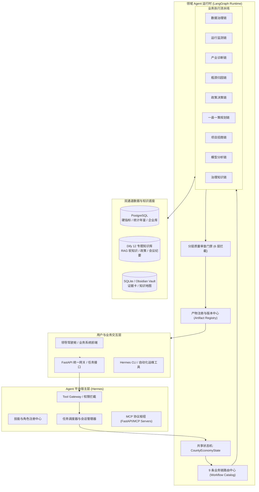

#### 2.1.2 框架选型：从单体对话脚本到工业级图状态机架构迁移
项目早期曾采用 OpenClaw 探索多智能体协作。但在长链路业务落地时遇到若干稳定性问题，随后迁移至 Hermes 宿主与 LangGraph 运行时架构：

| 对比维度 | 早期 OpenClaw 阶段 | 迁移后 Hermes + LangGraph 架构 | 迁移原因与实际收益 |
|---|---|---|---|
| **架构形态** | 偏对话网关，角色以独立脚本和 Prompt 离散存在 | 工业级宿主 + LangGraph 状态机 | 单一 Agent 难以承载企业级长流程业务 |
| **业务流程控制** | 依赖 LLM 自发对话与 ReAct 循环，容易偏航跑飞 | 代码硬编码固定 DAG 拓扑 + 条件分支 | 政务分析要求 100% 流程确定性与可复现性 |
| **工具协议** | 私有 Python 工具适配器，耦合紧 | 标准化 MCP (Model Context Protocol) 服务 | 工具模块解耦，支持跨系统独立部署和热插拔 |
| **状态持久化** | 内存运行时变量，进程挂掉全部丢失 | 结构化 State + 产物注册表 + 阶段断点持久化 | 支持长时间后台异步计算任务与产物溯源 |
| **交付形态** | 纯聊天窗 Markdown 输出 | Markdown 报告 + JSON 结构化矩阵 + Word 送审稿 | 满足政务系统对结构化数据与公文交付的格式要求 |

#### 2.1.3 架构哲学：工作流骨架嵌装受控智能体的确定性控制律
在政务经济分析场景中，纯自主智能体（Autonomous Multi-Agent）和传统硬编码工作流各自存在致命缺陷：
- **纯自主智能体的硬伤**：大模型自由决策容易跳步、指标统计口径无法对齐、面对长链路容易产生注意力幻觉与越权推断；
- **传统固定工作流的硬伤**：无法解析口语化政务诉求、无法理解非结构化政策意图、无法从杂乱的调研文本中萃取归纳。

**系统确立的核心架构原则**：
> **让确定性代码决定“必须做什么、允许做什么、什么时候停止”，让大模型决定“如何理解资料、如何组织结论、如何高质量表达”。**
主流程是强控制的 LangGraph 状态机；大模型只在资料归纳、瓶颈假设生成、政策匹配和报告撰写等特定节点以 Agent/Subagent 形态受控接入。

#### 2.1.4 双层闭环：宏观状态机调度与微观工具闭环的协作设计
根据现代软件工程对 Agent 的最小定义：

$$\text{Agent} = \text{LLM} + \text{Context} + \text{Tools}$$

外层由 **Harness（宿主运行时）** 驱动。传统的单向开环 LLM 应用仅是“输入 $\to$ 检索 $\to$ 生成”，中间一旦失败无法自我纠正。为了兼顾政务工作流的强确定性与智能体的自适应能力，本系统在架构上设计了**“宏观工作流（Outer Workflow DAG）+ 微观自治闭环（Inner Tool Loop）”**的双层嵌套机制：

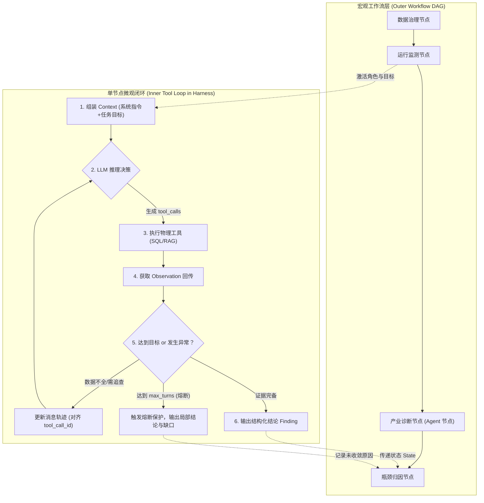

1. **宏观层（Outer Workflow DAG）**：由 LangGraph 控制全局业务拓扑（如必须先完成运行监测与产业画像，才能进入瓶颈归因）。这一层由代码 100% 决定流转路径，模型无权越权跳转分支；
2. **微观层（Inner Tool Loop in Harness）**：在具体的研判节点（如产业链断点分析）内部，模型在 Hermes/Runtime 提供的 Harness 循环中运行，不采用单次无反馈生成：
   - 模型发起结构化 `tool_calls`（如查询规上玻陶企业清单）；
   - Harness 负责物理调用数据库，严格遵循协议对齐 `tool_call_id`，将结果作为 `role: tool` 消息压入上下文；
   - 模型根据物理观测发现某关键环节配套企业缺失，自主触发第二轮 `tool_calls`（进一步检索外地供应商数据库）；
   - **硬性熔断控制**：Harness 设定了严格的 `max_turns = 6` 硬性退出门禁与单次调用 20s 超时熔断，绝对禁止模型由于外部异常陷入无限调用死循环。

#### 2.1.5 控制边界：工位节点分类矩阵与 Agent 选型决策准则
开发复杂系统时，容易将所有模型调用和简单脚本泛化为 Agent。依据控制权归属（代码 vs 模型）与执行路径的确定性，系统将所有节点划分为三类：

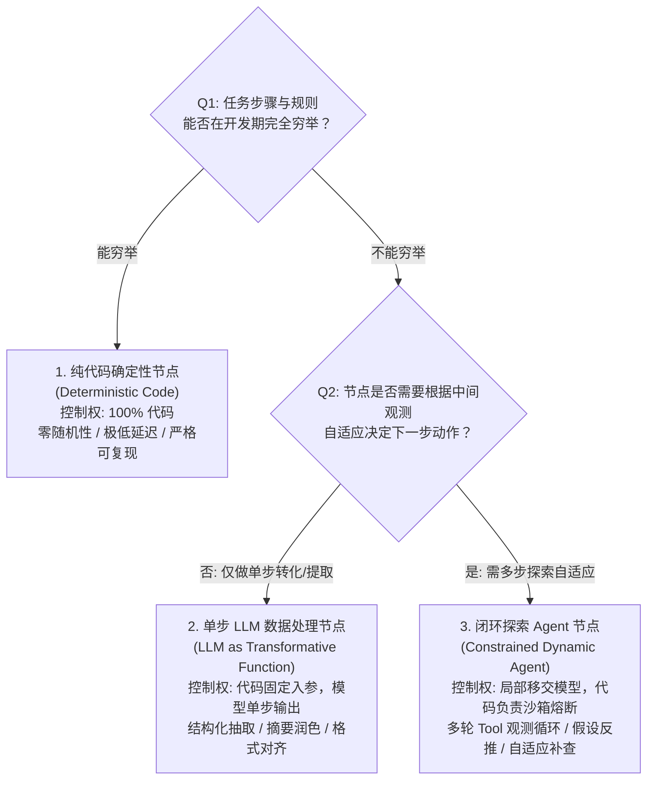

| 节点类型 | 系统内典型实现场景 | 控制权归属 | 为什么不采用其他模式？ |
|---|---|---|---|
| **1. 纯代码确定性节点** | 宏观指标同比/环比计算、区位商（LQ）公式测算、数据资产编目、Tool Gateway 权限拦截、PostgreSQL 物理只读查询 | **100% 代码控制** | 属于严格数学统计与政务安全防线，容忍度为 0，严禁大模型参与介入产生幻觉或计算漂移。 |
| **2. 单步 LLM 处理器** | 运行态势文字摘要提炼、预警成因公文润色、规划公文排版对齐、复杂自然语言指令意图分类 | **代码固定 DAG，模型单步生成** | 输入输出上下文明确，无需多步工具探索，单次 Prompt 即可完成高信噪比表达。强行 Agent 化只会徒增延迟与成本。 |
| **3. 闭环探索 Agent 节点** | 产业链断链溯源（需根据企业画像动态追查上下游供应商）、瓶颈归因假设反推（需根据多源线索交叉核验）、一县一策规划章节编排协同 | **局部移交模型自主决策，Harness 硬熔断** | 搜索空间广阔，无法预先穷举所需资料；需要根据工具返回的真实物理观测动态决定下一步补查什么证据。 |

这种清晰的分类确保了**“该硬的绝对硬（零波动），该活的在沙箱里受控探索（自适应）”**。

### 2.2 核心运行时与智能体交互范式：协议、因果与协同

#### 2.2.1 运行时模型：生产级 Agent 七大核心模块时序映射与完成判据
脱离三方库的浅层封装，一个可维护的工业级 Agent 系统必须具备清晰的七大模块分工。本系统对这七大模块的工程落地映射如下：

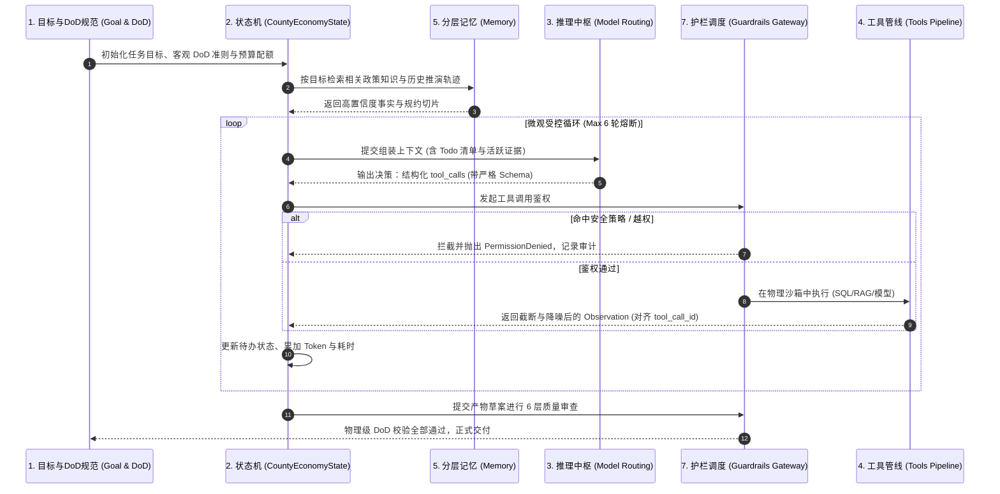

#### 核心模块落地映射一览：
1. **Goal & Specification（目标与客观完成判据 DoD）**：
   - *拒绝模型主观自夸*：系统彻底打破“只要模型输出文字就当成任务完成”的缺陷，确立严格的**客观物理级完成判据（DoD）**：
     - ① 所有必填结构化产物文件（`.md` / `.json` / `.docx`）物理落盘且 Schema 校验 100% 成功；
     - ② 穿透 6 层质量门禁，0 项 P0 违规拦截；
     - ③ `reasoning_trace.json` 证据链完整闭合，所有引用均有对应数据源 ID；
     - ④ 脚本进程退出码（Exit Code）严格为 0。只有同时满足上述 4 条客观指标，任务才被判定为 `succeeded`。
2. **State（强类型序列化状态机）**：
   - 显式维护 `CountyEconomyState`，将待办清单（`todo_list`）、活跃证据文件（`active_evidence_refs`）、资源用量（`budget_tracker`）显式独立维护，防止在长上下文中重复试错。
3. **Model（结构化输出契约与路由）**：
   - 严禁让模型自由输出非标准文本再用正则匹配，核心交互全量采用原生 Function Call / Pydantic 结构化数据协议；轻量意图分类路由至 7B 级小模型，深层推演调用顶尖模型。
4. **Tools（工具管线四道防护机制）**：
   - ① **Schema 校验**（Pydantic 强校验入参）；② **环境隔离**（PostgreSQL 物理只读账号与无权限子进程）；③ **输出信噪比控制**（SQL 强制截断，大结果返回引用句柄）；④ **状态幂等与事务回滚**。
5. **Memory（四层分层记忆体系）**：见 3.4 节详解。
6. **Planner（规划策略矩阵）**：
   - 宏观采用 **Plan-and-Solve**（业务链预先编排），微观采用 **ReAct**（探索节点边查边走），后置门禁采用 **Critique / Reflection**（自我反思与质检补丁）。
7. **Guardrails & Harness（硬性护栏与运行时管控）**：
   - 外部代码硬编码熔断、Tool Gateway 权限强校验与 Human-in-the-Loop 原生挂起。

#### 2.2.2 协议交互：Tool Calling 底层交互机理与因果原子绑定规范
在系统工程实现中，大模型不具备在服务器上主动执行代码的物理能力。所谓的工具调用，本质上是由 Harness 驱动的双轮次（Two-Turn）HTTP 协议循环推进：

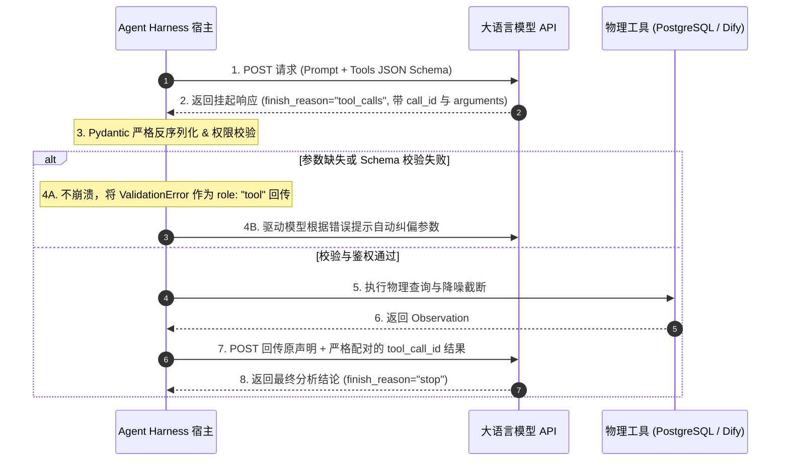

#### 底层协议工程落地的三大准则：
1. **因果绑定硬性配对（Causal Pairing Invariance）**：
   - 模型返回的每一个 `tool_calls` 项都包含全局唯一标识符（如 `call_metric_091`）。Harness 回传执行结果时，必须严格包装为 `role: "tool"` 且携带相同的 `tool_call_id`；
   - **原子性保全（杜绝孤儿调用）**：在上下文动态修剪（Context Pruning）或步骤回退时，系统必须以 `(assistant.tool_calls, tool_results)` 为最小不可分割原子对。严禁只修剪工具结果而保留调用声明，或保留声明而丢失结果，否则会直接引发 API 400 协议校验崩溃。
2. **参数校验失败的自纠闭环（Schema Self-Correction）**：
   - 当模型返回的 `arguments` 缺失必填字段或格式不合规时，Harness **绝对禁止抛出未捕获异常导致任务崩溃**。系统捕获 Pydantic `ValidationError` 后，将其标准化格式化为机器可读报错信息回传给模型（如 `{"error": "缺失必填字段 'period'，请提供 4 位年份"}`），赋予模型在当前步骤原地自纠纠偏的能力。
3. **零信任参数业务鉴权（Zero-Trust Parameter Guard）**：
   - 即使模型生成的入参通过了 JSON Schema 校验，Harness 依然视其为不可信输入。例如，必须强行比对 `county_code` 是否在当前登录用户的行政管辖授权范围内，严禁跨权限越权调数。

#### 2.2.3 核心范式：Planning、Reflection 与 RAG 三元协同防错配架构
在复杂智能体系统中，Planning（任务规划）、RAG（知识检索）与 Reflection（自省质检）常被误解为可以相互替代的概念。系统确立了严格的三元解耦边界，杜绝三大典型能力错配：

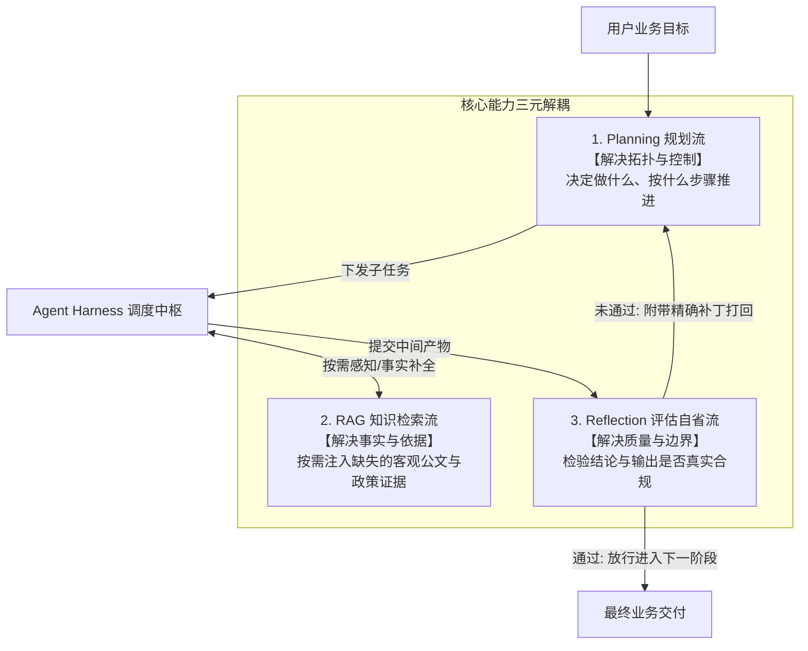

#### 三大工程避坑原则与选型决策：
1. **事实缺失严禁依靠 Planning 脑补（知识盲区熔断）**：
   - 当遇到特定区县的核心指标或政策缺位时，系统严禁通过“让模型多想几步”来推导事实，必须直接触发 RAG 工具检索，若底层无数据则强制抛出 `missing_metric_tasks` 补数任务，从源头掐灭逻辑幻觉；
2. **能用确定性代码断言绝不引入 LLM 反思（Reflection 三级火箭）**：
   - 优先采用 Python 代码编写的 **L1 确定性硬断言**（数字出处比对、文号白名单、敏感词正则）；
   - 仅对长篇规划的主观公文体例和发改委规范，才下沉给 **L2 专职 Critic 模型**；
3. **规划架构选型：一县一策的分层规划（Hierarchical Supervisor-Worker Planning）**：
   - 顶层由 `county_planning_chief`（Supervisor）确立战略定位与 5 大章节里程碑骨架；底层由章节撰写节点（Workers）在局部沙箱中完成具体分析，并通过门禁反馈触发动态 Replanning，兼顾全局一致性与局部灵活性。

#### 2.2.4 拓扑选型：单 Agent 与多 Agent (Supervisor-Worker) 工程边界
在业界讨论中，多智能体（Multi-Agent System）常被包装成“虚拟公司/多角色聊天室”等拟人化噱头。在严肃政务工程中，无约束的角色自由对话只会导致 Token 指数级爆炸、延迟飙升至数分钟并极易死锁。
系统坚决剥离拟人化噱头，从**分布式计算中的上下文隔离、权限边界、并发吞吐与状态确定性**四个工程维度，明确单体与多 Agent 的分界：

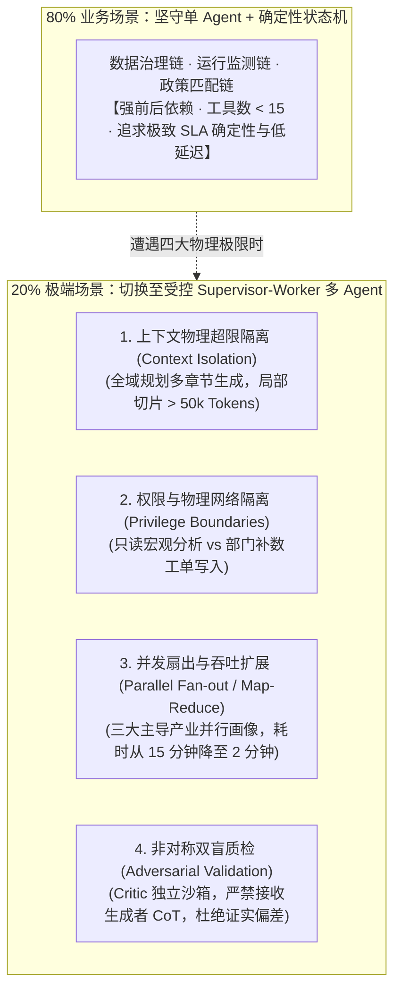

#### 工业级拓扑选型铁律：
- **坚决采用主从分发型（Supervisor-Worker）**：由总调度节点掌握全局状态，向专业子智能体（Worker）派发子任务。**Worker 之间互不可见、严禁横向私聊**，执行完毕仅回传精炼的结构化摘要，主上下文体积始终维持在健康低水位；
- **严禁使用网状点对点（P2P Mesh）**：在生产环境中彻底封杀多智能体广播与自由聊天拓扑，杜绝通信风暴与死锁震荡。

### 2.3 基础设施韧性与长周期治理：稳态运行底座

#### 2.3.1 稳态底座：Agent Infra 三层分工与模型 API 四级超时治理

将政务智能体从本地单机原型推向省级发改委 183 县生产环境，系统必须直接面对分布式环境下的硬核物理挑战：计算节点 Pod 遭遇 OOM 重启导致执行丢失、外部大模型 API 遭遇网络抖动或 429 限流、工具重复执行导致脏数据污染、以及模型生成代码越权逃逸等。为此，平台确立了明确的三层职责分工体系：

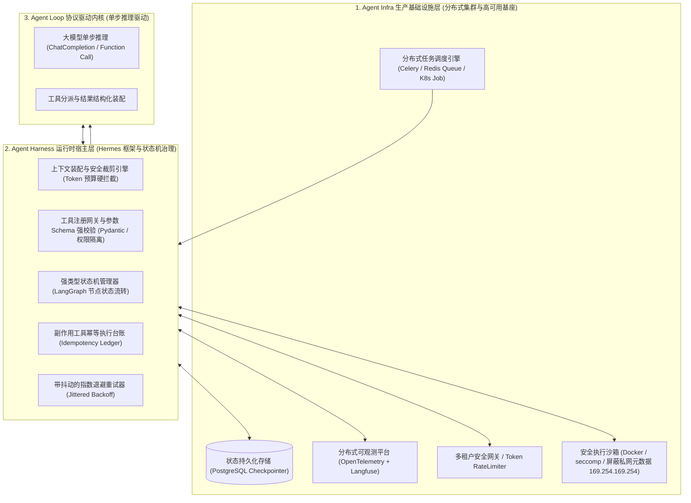

各层边界与关注点遵循严格的职责正交原则：
- **Agent Loop（内核）**：仅负责单步模型调用与工具调用声明的分发解析，无外部存储依赖；
- **Agent Harness（宿主）**：管理局部内存轨迹、上下文裁剪、参数校验、异常重试与执行步数预算；
- **Agent Infra（底座）**：负责集群任务持久化、节点崩溃自愈、分布式链路追踪、沙箱资源隔离与多租户审计。

#### 1. 外部大模型 API 四级超时控制矩阵
在长程政务规划生成中，简单的单一 HTTP 超时（如 `timeout=60s`）无法应对流式输出与深度思考。系统构建了四级递进超时防护矩阵：

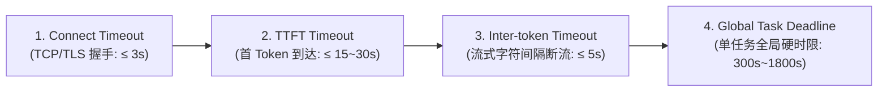

- **Connect Timeout（≤ 3s）**：限制底层 TCP 连接与 TLS 握手时间，防止网关连接池挂起或 DNS 解析死锁；
- **TTFT（Time-To-First-Token）Timeout（15s ~ 30s）**：请求发出到服务端输出第一个 SSE 数据包的时限。针对深度思考推理模型可放宽至 30s，防止请求无限排队拥堵；
- **Inter-token Timeout（≤ 5s）**：流式传输中，相邻两个 Chunk 之间的传输间断上限。若超过 5s 无任何新字符推送，判定为网络中间僵死，主动切断连接避免 Worker 线程永久挂起；
- **Global Task Deadline（300s ~ 1800s）**：单任务总硬性时限。常规宏观指标分析限时 300s，隆昌全域数智化规划宏观长任务限时 1800s，超时强行熔断并回滚，防止模型动作死循环空耗费用与资源。

#### 2. 带随机抖动的指数退避策略（Jittered Backoff）
面对模型厂商偶发的 HTTP 429（Rate Limit）与 5xx 故障，系统坚决杜绝固定间隔重试，采用带随机抖动的指数退避算法：
$$T_{\text{sleep}} = \text{random}(0, \, \min(T_{\max}, \, T_{\text{base}} \times 2^{\text{attempt}}))$$
通过引入随机抖动，彻底打散 183 县并发任务高峰期的重试脉冲，避免数百个 Worker 在同一毫秒内重试引发次生雪崩。

#### 2.3.2 循环治理：外部验证器驱动退出与 Loop 自收敛控制律

在单次调用或简单链式调用中，关注点往往落在 Prompt 遣词造句与 Tool Schema 上。但在数智化转型规划生成与多源数据治理等长程多步 Agent 中，绝大多数严重的线上故障出在**循环控制流（Loop Control Flow）**层面。系统从工业级循环工程视角，建立了严格的自收敛控制律：

#### 1. 政务场景下循环失控的四种典型病灶


#### 2. 第一铁律：外部验证器驱动退出（Verifier-driven Exit）
平台确立了绝对不可动摇的循环终止法则：**严禁将“大模型的自主回答或自我宣称”作为任务终止的最终信任源。退出判定必须移交至外部确定性验证器（Deterministic Verifier）。**

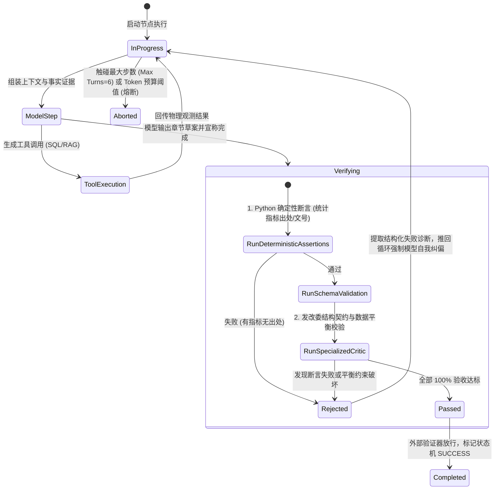

- 当模型输出“隆昌产业发展章节已撰写完毕，全部符合省发改委规范”时，Harness **坚决不认可其终止声明**；
- 状态机自动路由至外部 Verifier 节点，执行 Python 代码断言（比对年鉴数据精确出处、公文红头文号白名单、敏感词检测）与 Schema 校验；
- 仅当验证器返回退出码为 0 时，才允许状态转移至 `COMPLETED`；若未通过，验证器输出的具体失败上下文（如 `"AssertionError: 装备制造业产值增速与第三章统计底表不一致，差值为 4.2%"`）被包装为系统反馈直接注入下一轮循环，强迫模型精准重写。

#### 3. 三轮平缓剪枝控制律（Pass@N Convergence Pruning）
在循环迭代中，模型自我纠偏能力服从收益递减规律：
- **Pass@1（一次通过率）**：约为 $62\%$；
- **Pass@3（3 轮自愈通过率）**：上升至 $91\%$；
- **收敛截断铁律**：经验测试表明，若连续 3 轮外部验证器均驳回，说明模型已陷入认知盲区或遭遇物理不可行约束（如资源禀赋客观无法同时满足两项省定指标），第 4 轮及以后的重试通过率趋近于 0。此时系统直接**熔断早停，将现场上下文冻结并转为人工专家待办工单（Escalate to Human）**，杜绝无意义的 Token 燃烧。

#### 2.3.3 运行时进化：情节反思、动态工具自举与防中毒安全门禁

大模型的基座权重在部署后是完全冻结的。在四川省 183 县多变而复杂的实际政务落地中，各县统计表头口径微调、部门接口变动或长尾专有行业分析需求层出不穷。若每次业务调整都依赖工程师人工修改代码与 Prompt，系统的维护成本将随时间呈指数级上升；而触发模型权重微调（Fine-Tuning）又面临样本需求大、训练周期长、黑盒难以解释及易引发“灾难性遗忘”等致命痛点。
系统创新地确立了**“冻结模型权重，通过运行时外化资产自进化（In-Context Self-Evolution）”**的工程范式：

#### 1. 运行时外化自进化 vs 权重微调
| 评估维度 | 模型权重微调（Fine-Tuning / RLHF） | 运行时外化自进化（In-Context Evolution） |
| :--- | :--- | :--- |
| **样本需求量** | 需数千条专业对齐语料 | **极少样本（1~3 次典型发改委专家驳回与修正案例即可沉淀）** |
| **生效周期** | 天级或周级（数据清洗、集群训练、评测验收） | **分钟级（经验写入情节记忆或自举工具测试通过后即刻全局生效）** |
| **可解释性与回滚** | 极低（隐式权重黑盒，无法精准排障） | **极高（生成的 Python 工具代码与反思文本完全人类可读，支持一键灰度与回滚）** |
| **模型基础能力** | 易引发灾难性遗忘与通用泛化能力衰减 | **零副作用（基座模型完全冻结，外挂知识与工具动态隔离）** |

#### 2. 三大自进化工程机制落地


- **机制 1：情节反思沉淀（Reflexion Pattern）**：
  当任务发生错误重试或被质量门禁驳回时，专职复盘 Worker 深度分析执行轨迹的分叉点，提炼针对该特定区县和指标的**布尔型负向规避准则**（例如：`“在查询隆昌玻陶产业历史能耗时，必须剔除 2021 年退城入园企业的搬迁过渡能耗，否则会导致工业产值能耗比虚高 32%”`），写入向量情节记忆库。后续同类任务前置召回并作为动态 Few-shot 注入上下文，防止“重复踩坑”；
- **机制 2：动态工具自举合成（Tool Synthesis）**：
  面对 183 县高频复杂的跨表统计计算（如同时测算主导产业 3 年复合增速、工业用电弹性系数及前 20 强企业税收集中度），Agent 不再每次耗费 8 轮琐碎 SQL 与多步推理拼装，而是自主生成一段参数化 Python 聚合工具代码（如 `calc_industrial_cagr_and_elasticity.py`）并附带 3 组单元测试用例。沙箱测试全绿后，自动生成 JSON Schema 并动态注册进工具网关，后续任务单步原子调用即可完成，推理 Token 与耗时下降 $70\%$；
- **机制 3：提示词策略离线自优化（Prompt Auto-Tuning）**：
  基于 200+ 题 Golden Set 长期评测大盘的薄弱项，离线优化模型自动优化专家角色的系统指令，经基准测试无退化后生成 PR 供工程师核准。

#### 3. 防中毒安全门禁（Anti-Poisoning Gate）
自进化最致命的隐患是“假性经验固化与恶意注入（Feedback Poisoning）”。系统设置了三重不可跨越的准入防线：
1. **记忆置信度半衰期机制（Memory Half-Life）**：
   每条沉淀的反思记忆赋予初始权重 $W_0=1.0$。后续任务引用该经验且通过质量门禁，置信度提升（$W \leftarrow W + 0.2$）；若引用后任务仍失败或被发改委专家驳回，扣减置信度（$W \leftarrow W - 0.4$）；一旦 $W < 0.3$ 则自动逐出记忆库，彻底淘汰失效经验；
2. **测试驱动的沙箱隔离准入（Test-Driven Admission）**：
   任何自动合成的工具代码，必须自带至少 3 组覆盖极端边界的单元测试，并在隔离的 Docker 临时容器中执行，要求退出码为 0 且无超时。**工具仅限只读 SQL 与数据转换，严禁任何包含写副作用的代码自举**；
3. **人类终审（Human-in-the-Loop Sign-off）**：
   涉及全省通用性规则更新或涉及敏感指标口径的经验，系统自动在管理后台生成待办工单，必须经省级发改委业务专家在线签署确认后方可合入全省主干知识库。

#### 2.3.4 异步协同：长周期任务挂载、会话挂起与安全 Webhook 唤醒

大语言模型的标准 Tool Calling 建立在**同步 RPC 请求-响应**的假设之上：模型声明工具调用，当前线程阻塞等待结果返回，随后驱动下一步推理。
然而，在真实政务运行场景中，工具物理耗时的分布呈现出极度不对称的跨度：
- 查询 PostgreSQL 统计指标：$10\sim 50\text{ms}$；
- 183 县大规模偏离份额分析（SSA）与 50+ 份 Word 报表排版渲染：$3\sim 15$ 分钟；
- 跨部门数据归集与补数填报（如经信局补录企业能耗）：**需 24 ~ 72 小时**；
- 省市发改委专家审批签字（Gate 6 人工终审）：**需数小时至数天**。

若采用传统的同步长连接阻塞，网关必然在 60 秒内触发 HTTP 504 Gateway Timeout 报错崩溃；Worker 进程持续占满显存与文件描述符导致集群雪崩；且中间若遇 Pod 滚动升级，内存中未完成的规划现场将彻底灰飞烟灭。
为此，系统全面重构为**基于事件驱动的异步会话挂起与恢复体系（Suspension & Resumption Architecture）**：

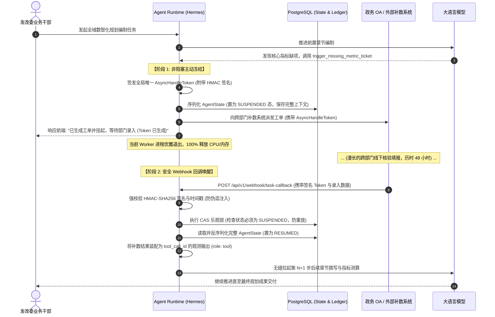

#### 核心工程防御机制：
1. **状态机全现场原子落盘**：会话挂起时，系统完整持久化结构化业务变量、`messages` 轨迹、活跃专家角色配置及门禁上下文快照，支持任务跨节点与长周期后的精准恢复；
2. **HMAC-SHA256 签名与时效防护**：签发的 `AsyncHandleToken` 包含任务 ID、节点标识与时效戳，外部回调到达时，网关严格执行秘钥验签与 72 小时过期判定，严禁任何伪造的“审批通过”或恶意注入；
3. **CAS 乐观锁防重复投递**：利用数据库原子条件更新（`UPDATE task_state SET status='RESUMED' WHERE token=? AND status='SUSPENDED'`），面对外部网络超时导致的多次重试回调，仅首次处理成功，后续自动拦截忽略，实现绝对幂等。

### 2.4 LangGraph 图状态机高阶拓扑工程演进：复杂决策流重构

#### 2.4.1 状态图演进：State-Node-Edge 控制权反转与图引擎基石

在很多早期大模型应用开发中，开发者最直观的写法通常是将多个步骤以线性流水线的方式串联起来（即所谓的“链式调用”或 LCEL 链）：
```python
# 链式调用的脆弱原型
raw_data = step1_fetch_county_data(county_code)
diagnosis = step2_diagnose_bottlenecks(raw_data)
final_report = step3_generate_policy_outline(diagnosis)
```
这种模式在原型验证期简单直观，但在进入真实复杂的严肃县域经济治理场景后，线性链式调用遭遇了三项确定性的系统工程瓶颈：
1. **条件分支导致代码结构膨胀**：真实政务研判绝非单向流水线。若宏观指标出现异常预警，需动态分流至瓶颈诊断分支；若主导产业数据缺损，需分流至部门补数审批分支。链式调用必须借由多层嵌套的 `if-else` 实现，业务逻辑被大量的控制流胶水代码彻底淹没，每次新增产业规则都会引发全局回归缺陷；
2. **无法原生表达循环、自省与自愈重试**：当生成的一县一策方案在质量门禁中被驳回时，系统必须捕获未达标项并带着审查补丁返回前置节点重新修订。链式调用必须在外部包裹命令式 `while True` 循环，使重试逻辑散落为黑盒暗箱操作，破坏了链路追踪并极易发生死锁；
3. **隐式状态传递导致数据契约与快照能力丧失**：线性调用依赖局部变量在内存调用栈中层层传递。当流程延伸到第 10 步时，根本无法明确当前节点到底依赖前序哪些字段；且一旦由于网络抖动发生异常，局部变量随调用栈释放而彻底蒸发，系统无法实现断点续跑。

为此，系统从底层彻底摒弃线性链条，全面进化为**基于有限状态机（Finite State Machine）与计算图（Computation Graph）的 LangGraph 架构**，确立了控制权反转（Inversion of Control, IoC）的三大核心元语：

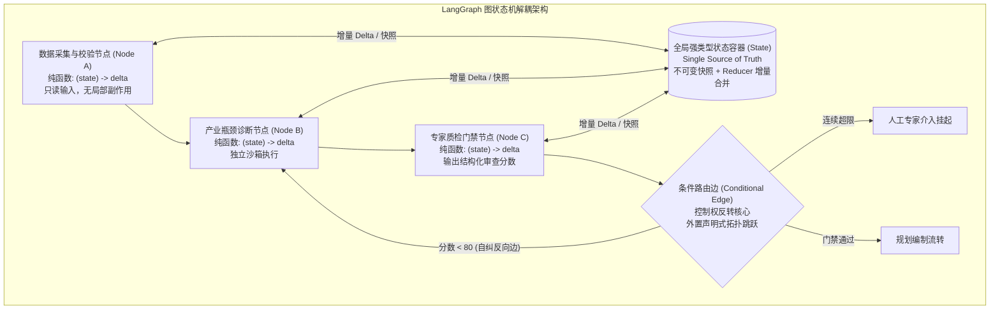

#### 状态图三大核心工程基石：
1. **State（单一事实源状态容器）**：
   以 Pydantic 强类型声明全局 `CountyEconomyState`，定义明确的数据契约与 Reducer 规则。所有节点只从该状态读取上下文切片，节点之间严禁直接通过内存对象隐式传参；
2. **Node（纯函数原子节点）**：
   每一个节点都是独立的纯计算单元，函数签名统一约束为 `(state: ReadOnlyState) -> dict`。节点内部**严禁原地修改（In-place Mutation）入参状态**，仅计算并返回局部的增量差异（Delta），由 LangGraph 运行时 Reducer 安全合并，确保每个执行步具备确定性的快照生成与时间旅行（Time Travel）回溯能力；
3. **Edge / Conditional Edge（控制权反转的拓扑边）**：
   节点自身不包含任何“下一个调用谁”的控制流逻辑。所有的条件跳转与重试回路被单独外置于条件边中（`add_conditional_edges`）。控制权从节点内部反转至图引擎，使整条业务链的执行拓扑在编译期即可一览无余，支持渲染为可视化拓扑并流式捕获单步快照；
4. **Topological Fan-out / Fan-in（拓扑层级的一等公民并发扇出与汇聚）**：
   将 15 个统计指标库、重点项目库与规上企业库的并发查询，从单节点内部命令式 `asyncio.gather` 封装升维为图拓扑结构上的并发分支，赋予每个并行数据分支独立的超时熔断、独立重试与全链路可观测性。

#### 2.4.2 数据流规范：三态生命周期建模与显式 Reducer 规约

在 LangGraph 状态图的生产演进中，针对长链路任务中数据混乱、状态覆盖和内存膨胀问题，团队确立了三项关键的状态工程规范：

#### 1. 状态模型的三态生命周期分层（Three-Tier State Lifecycle）
严禁将所有字段扁平杂糅在单个字典中。`CountyEconomyState` 严格区分为三个正交生命周期阶段：
1. **外部必选输入（Required Inputs）**：启动任务时由客户端传入的确定性元数据（`county_code`, `target_year`, `workflow_id`）；
2. **阶段加工中间态（Intermediate Optional）**：由各工位节点逐步计算出的特征、指标与诊断事实，**必须显式声明为 `Optional` 并附带默认初始值（`None`）**；
3. **最终交付产物（Deliverables）**：送审规划草案、政策矩阵、招商清单等最终文件句柄。

```python
from typing import TypedDict, Optional, List, Annotated
import operator

class MultiTierCountyState(TypedDict):
    # --- 1. 外部必选输入 ---
    county_code: str
    target_year: str
    workflow_id: str
    
    # --- 2. 过程加工中间字段 (强制声明为 Optional) ---
    is_valid: bool
    error_message: Optional[str]
    macro_metrics_snapshot: Optional[dict]
    bottlenecks_identified: Optional[List[dict]]
    enterprise_supply_chain: Optional[dict]
    
    # --- 3. 最终交付产物与审计流 ---
    final_policy_matrix_excel: Optional[str]
    audit_trace: Annotated[List[str], operator.add]
```

#### 2. 显式 Reducer 规约策略与业务去重合并（Deduplicated Reducer）
LangGraph 底层对状态的默认更新机制为浅层字典覆盖（Shallow Merge）。对于列表型容器（如历史消息 `messages` 或事实证据 `evidence_list`），若未配置 Reducer，后续节点返回同名键时将**直接抹除前序节点积累的所有历史数据**。
系统对所有列表容器强制施加 `Annotated` 规约修饰，并针对业务证据链开发了基于唯一业务主键（`evidence_id`）的**自动去重 Reducer**：
```python
def deduplicate_evidence_reducer(current: List[dict], new_items: List[dict]) -> List[dict]:
    """工业级业务证据链去重追加 Reducer"""
    merged = {item["evidence_id"]: item for item in current}
    for item in new_items:
        merged[item["evidence_id"]] = item
    return list(merged.values())

class RobustCountyState(TypedDict):
    messages: Annotated[List[dict], operator.add]
    evidence_list: Annotated[List[dict], deduplicate_evidence_reducer]
    audit_trace: Annotated[List[str], operator.add]
```
彻底保障了多节点接力过程中，前序数据治理专员查出的核心指标与后续归因专家追加的调研证据得以无缝、无损增量累加。

#### 3. 临时密集计算状态作用域隔离（Transient State Scoping）
在计量模型分析师（`quant_model_analyst`）运行偏离份额分析（SSA）或多元回归时，涉及上万行原始 DataFrame 与高维协方差矩阵。系统严格实施**局部瞬态隔离**：中间运算大对象仅在节点内部函数作用域存活，节点向外返回字典前强制经过 Pydantic Schema 白名单过滤，只允许轻量级结构化指标摘要（Summary Cards）回传合并至全局 State，杜绝 Checkpoint 快照网络拥塞与序列化阻塞。

#### 4. 下游节点防御性安全访问守则（Defensive State Accessor）
下游专家节点严禁使用直接下标（如 `state["enterprise_supply_chain"]`）强行取值，强制采用 `state.get()` 并配置缺数降级逻辑：
```python
def downstream_policy_node(state: MultiTierCountyState) -> dict:
    bottlenecks = state.get("bottlenecks_identified")
    if not bottlenecks:
        return {"audit_trace": ["downstream_policy: 前序瓶颈分析缺项，启用普惠兜底政策框架"]}
    return {"final_policy_matrix_excel": generate_matrix(bottlenecks)}
```
从代码层面彻底消灭因前置接口超时或缺数引发的 `KeyError` 异常硬崩溃。

---

#### 2.4.3 拓扑控制：强类型枚举路由、即时短路熔断与多阶逃生通道

为实现复杂业务流转的极致可控与可审计，系统将动态条件分支（Conditional Edges）全面升级为工业级拓扑控制中枢：

#### 1. 基于 Pydantic `Literal` 受控枚举的强类型结构化路由决策
严禁大模型以自然语言自由文本决定下一步走向。意图分流与阶段路由节点强制通过 `with_structured_output` 绑定受控字面量枚举，并在装配条件边时显式传入 `path_map` 映射字典：
```python
from pydantic import BaseModel, Field
from typing import Literal

class StructuredRouteDecision(BaseModel):
    intent_branch: Literal["monitoring", "industry_diagnosis", "policy_decision", "out_of_scope"] = Field(
        ..., description="严格从预定义的四个业务分支枚举中选择最匹配的一项"
    )
    confidence: float = Field(..., ge=0.0, le=1.0)
    routing_reason: str

# 显式映射表，在 compile() 阶段触发严格静态校验
builder.add_conditional_edges(
    source="intent_router",
    path=evaluate_route_branch,
    path_map={
        "monitoring": "monitoring_report_chain",
        "industry_diagnosis": "industry_diagnosis_chain",
        "policy_decision": "policy_decision_chain",
        "out_of_scope": "graceful_exit_node"  # 显式兜底逃生通道
    }
)
```
彻底杜绝了模型偶发输出“我认为属于招商”等非标字符串导致的运行时 `KeyError`，并在编译期保障了拓扑中所有目标节点的 100% 存在性。

#### 2. 节点单一职责与计算/拓扑解耦（严格控制权反转）
节点函数内严禁使用命令式 `if-else` 直接跨工序调用下游子业务，彻底拆解复合庞杂的“上帝节点”（God Node）。节点保持高内聚纯函数，专注于单一原子工序（如：纯 I/O 数据抓取 $	o$ 纯 CPU 清洗 $	o$ 计量算法计算 $	o$ LLM 报告撰写 $	o$ 事务持久化），所有条件分流上浮为拓扑图上的条件边声明。这赋予了系统灵活插拔节点、细粒度单独单测、以及出错原地局部重试的卓越工程弹性。

#### 3. 前置校验快速失败即时短路熔断（Fail-Fast Circuit Breaker）
在顺序子流程中，前置输入校验节点（`validate_input`）之后配置条件边。一旦发现区划代码错误或核心年份缺失（`is_valid == False`），条件边立即短路直达错误收口节点，跳过中间所有重型分析与大模型调用。从原本让后续 5 个节点各自手写 `if not is_valid: return {}` 贯穿空转的“幽灵空跑（Phantom Passthrough Runs）”，升级为毫秒级快速失败响应。

#### 4. 环形自纠回路的多阶逃生通道（Cyclic Loop Escape Hatch）
在质量门禁驳回并指回前序节点重新修订的环形自省回路（Cyclic Graph）中，路由函数严格与全局状态中的 `review_retry_count` 计数器强绑定，配置多阶逃生通道：
```python
def route_with_escape_hatch(state: MultiTierCountyState) -> str:
    if state.get("review_passed", False):
        return "approved_continue"
    retries = state.get("review_retry_count", 0)
    if retries >= 3:
        # 重试达 3 次上限，触发一级逃生：挂起并升级发改委专家在线核准
        return "escalate_to_human"
    return "retry_revision"

builder.add_conditional_edges(
    "review_gate_node",
    route_with_escape_hatch,
    {
        "approved_continue": "next_stage_planning",
        "retry_revision": "generator_node",          # 受控环形反向边
        "escalate_to_human": "human_approval_node"   # 刚性逃生通道，杜绝死锁
    }
)
```
坚决阻断任何因模型理解死结引发的无限循环与 `GraphRecursionError`（递归超限）崩溃。

---

#### 2.4.4 流式推进：逐工位事件驱动流 (app.stream) 与全链路可观测

在生产环境任务调度与 API 交付网关中，针对长长业务链运行，系统确立了**全面的流式事件驱动架构（Streaming Event-Driven Execution）**：
1. **彻底废除全量同步阻塞 `invoke()`**：在长达 30 分钟的 9 条业务链执行中，若仅使用 `invoke()` 同步等待最终 State，会导致业务系统前端长时间白屏，用户误判为卡死而频繁重复刷新，触发并发任务雪崩；
2. **落地 `app.stream()` / `astream()` 逐工位流式事件广播**：通过 Server-Sent Events (SSE) 或 WebSocket 向前端领导驾驶舱实时推送工位级状态事件，每一个 Node 完成计算即时广播增量 Delta 与进度百分比；
3. **毫秒级单步审计（Audit Trace Streaming）**：运维监控系统流式监听每个工位的产出键名与执行耗时，结合 OpenTelemetry 实时生成细粒度分布式 Span，实现长程多步骤调度的全透明可观测性。

---

#### 2.4.5 并发拓扑：受控扇出 (Fan-out)、弹性扇入与深度合并 Reducer

在主导产业错位发展规划与招商多维研判等重型业务链中，任务包含多个彼此无数据依赖的独立子工序（例如：同时评估产业能耗承载力、产业链缺环断点、财政税收贡献与规上企业技术专利）。
系统从传统的串行流水线全面升维至**受控 Fan-out（扇出并发）与弹性 Fan-in（扇入汇聚）拓扑架构**，将端到端延迟从累加模型 $t_{\text{total}} = \sum_{i=1}^n t_i$ 压缩至木桶极限 $t_{\text{total}} \approx \max(t_i)$。

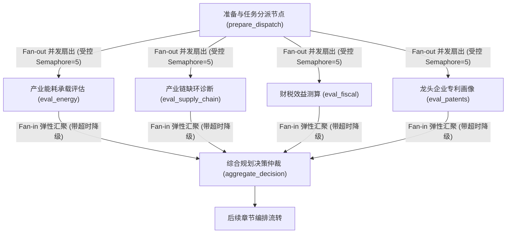

#### 高并发生产级四大约束与工程落地：
1. **信号量受控扇出（Semaphore-bounded Fan-out 防 429 限流雪崩）**：
   在单次任务并发扇出 10~15 个大模型评估工位时，瞬时高频请求极易打满云端大模型服务商的 TPM（Tokens Per Minute）与 RPM 限制，触发 HTTP 429 报错风暴。系统在并发层注入全局 `asyncio.Semaphore(5)` 信号量网关，动态控制活动并发 Worker 上限，既享受并行加速，又坚决防止配额击穿；
2. **弹性扇入与木桶短板治理（Elastic Fan-in & Straggler Mitigation）**：
   LangGraph 原生要求聚合节点等待所有上游完成。若某一外部数据源（如外部商业企业库）突发慢查询（耗时 40s），会导致其余仅耗时 1s 的节点全部被动停滞。系统为每个并发子分支设置**独立硬超时（如 8s）**：超时未响应的工位自动返回预设的缺数降级切片（`{"status": "timeout_fallback"}`），驱动聚合节点准时执行，消灭单点木桶短板；
3. **嵌套字典深度合并规约器（Deep Merge Dict Reducer）**：
   并发节点向全局状态提交复杂结构体时，传统的浅层字典更新会导致后完成节点覆盖先完成节点的子键。系统定制了递归深合并 Reducer：
   ```python
   def deep_merge_dict_reducer(current: dict, delta: dict) -> dict:
       """支持并发节点安全合并复杂字典的多级键值"""
       result = current.copy()
       for k, v in delta.items():
           if k in result and isinstance(result[k], dict) and isinstance(v, dict):
               result[k] = deep_merge_dict_reducer(result[k], v)
           else:
               result[k] = v
       return result

   class ParallelCountyState(TypedDict):
       dimension_evaluations: Annotated[dict, deep_merge_dict_reducer]
       review_traces: Annotated[List[str], operator.add]
   ```
   从底层杜绝了并发写入时的键覆盖与状态覆盖事故；
4. **运行时严格无隐式数据依赖（No Intra-Stage Cross Dependency）**：
   同一扇出层级的并发节点在运行时彼此完全物理隔离。凡存在计算前后序依赖的步骤，强制通过拓扑边串行编排，杜绝并发竞争。

---


---

#### 2.4.6 研报流水线：Prompt Chaining 多段门禁与反思注入编排

在县域决策支持场景中，生成《县域特色产业深度评估白皮书》（万字级）、《招商引资全景图谱》等重型政务交付物具有结构复杂、指标密集、因果链长与公文严谨等刚性特征。
早期若采用单次全量生成（One-shot Generation），大模型在超长上下文中面临严重的注意力稀释（Attention Decay）、后半段内容草率缩水甚至因 Max Output Tokens 溢出而被物理截断；且一旦前序指标存在偏差，整篇报告全盘报废，重跑耗费数万 Token 与上百秒时间。

系统基于 LangGraph `StateGraph` 全面落地 **Prompt Chaining 工业级四阶分步流水线**，将重型任务解耦为“提纲规划 $\rightarrow$ 章节扩写 $\rightarrow$ 指标交叉核验 $\rightarrow$ 行政公文润色”四个单一职责工位，并引入两段式确定性质检门禁与反思注入重试回路。

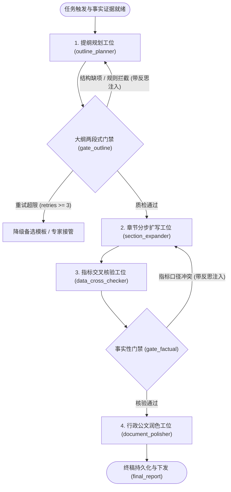

#### Prompt Chaining 生产级四大核心设计与落地规范：
1. **工位单一职责与显式状态切片隔离（Single Responsibility & State Field Isolation）**：
   在全局状态 `CountyReportState` 中为每个工位开辟专属持久化字段，坚决避免跨步骤隐式字符串拼接或覆盖：
   ```python
   from typing import TypedDict, Dict, List

   class CountyReportState(TypedDict):
       topic: str                       # 研报主题（如：成渝双城经济圈某县产业错位研判）
       outline: str                     # 第一步产出：结构化大纲与三级目录
       section_drafts: Dict[str, str]   # 第二步产出：按章节隔离的正文初稿
       cross_check_logs: List[str]      # 第三步产出：硬数据与政策事实交叉核验日志
       critique_feedback: str           # 质检驳回时的结构化反思修正建议
       outline_retries: int             # 提纲规划重试计数器
       final_report: str                # 第四步产出：终审定稿公文
   ```
2. **两段式混合质检门禁（Two-Stage Hybrid Quality Gate）**：
   彻底杜绝将所有质量判断盲目甩给大模型的反模式，实施分级阻断：
   - **第一阶（纯代码确定性 Fast-Fail）**：利用毫秒级 Python 正则与结构化规则，刚性断言小节数量（$\ge 4$ 个）、三级指标槽位覆盖率（工业增加值、能耗双控、规上企业专利等非空），失败时立即拦截，零 Token 消耗；
   - **第二阶（大模型语义对齐门禁）**：仅在第一阶规则通过后，调用轻量语义判别器核验论点与国家宏观产业政策导向的契合度。
3. **反思反馈注入的定向自纠回路（Feedback-Injected Reflection Loop）**：
   条件边驳回时不进行“盲目重试”。质检节点在 `state["critique_feedback"]` 中沉淀具体驳回诊断（如：“缺少工业用电量与规上工业增加值剪刀差分析”）。重试工位动态将该反馈组装至 Prompt，驱动针对性弥补缺陷，阻断同质化连续翻车。
4. **状态增量事件流与长任务进度可观测（State-Driven Stream Observability）**：
   万字研报生成通常耗时 40~90 秒。系统通过 `app.stream()` 捕获逐工位状态增量事件，通过 SSE 向前端看板实时广播当前工位进度（“正在规划大纲...”、“正在扩写第二章...”、“正在核验统计数据真实性...”），彻底杜绝前端超时与用户焦虑。


---

#### 2.4.7 模型治理：统一协议映射、连接池托管与节点级退避降级

县域经济智能分析与协同决策平台在实际严肃政务落地中，面临双重严苛挑战：
1. **宏观与开放分析诉求**：宏观战略对齐、长文本综合研报撰写等重型任务，需要依赖前沿云端商业模型（如 DeepSeek-V3 / Qwen-Max / GPT-4o）的高阶推理与超长上下文能力；
2. **政务合规与数据涉密底线**：区县级未公开财税底表、涉密企业财务、重点项目投资明细及信访维稳信息，受到《数据安全法》与政务数据分类分级红线的严格约束，**数据物理严禁出内网**，必须强制路由至政务私有云内网部署的开源模型集群（如 vLLM 托管的 Qwen-2.5-72B / 14B、Ollama 离线推理实例）。

为解决异构模型差异、公私网环境切换与突发网络抖动问题，系统确立了**异构模型统一纳管与运行时韧性架构**。

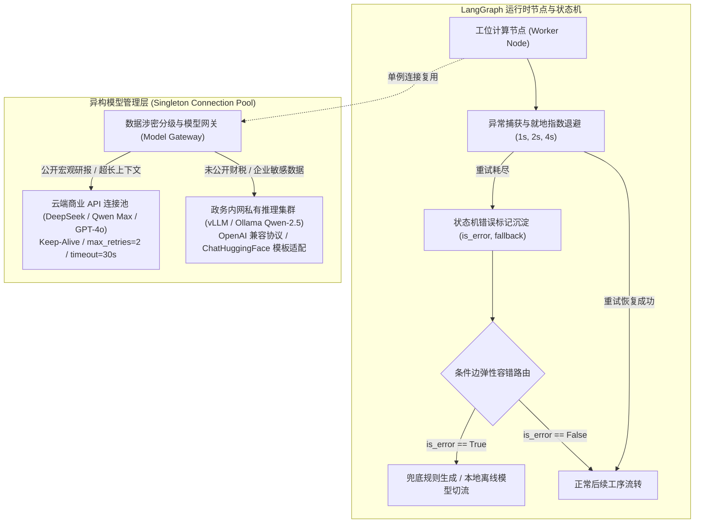

#### 异构模型纳管与运行时韧性四大工程规范：
1. **长连接池生命周期管理与单例托管（Managed Singleton Connection Pool）**：
   彻底禁止在节点函数内部动态执行 `llm = ChatOpenAI(...)`。服务启动时由工厂统一初始化全局 `ModelClientPool` 单例，预分配 HTTP 连接池并启用 TCP Keep-Alive。这消除了单次调用 80~150ms 的 TLS 握手开销，并在并发扇出（15+ 节点）时避免操作系统端口耗尽（防范 TIME_WAIT 堆积导致的 `Cannot assign requested address`）；
2. **异构模型统一协议抽象与 Tokenizer 模板自动适配（Unified Chat Protocol & Tokenizer Adapter）**：
   上层业务节点纯粹依赖标准 `ChatPromptTemplate` 与 `SystemMessage` / `HumanMessage` 对象进行交互，严禁在业务代码中硬编码任何特殊 Token（如 `[INST]`、`<|im_start|>` 等）。底层通过 `ChatHuggingFace` 与兼容 OpenAI 标准的 `/v1` 端点（vLLM），由驱动层自动读取各开源模型（Qwen、Mistral、Llama-3）对应的分词器特殊标记映射规则，保障多模型无缝热插拔切换且永不发生格式错位；
3. **强类型结构化输出驱动（Structured Output Binding）**：
   全面采用 `with_structured_output(PydanticModel)` 替代传统的自然语言输出加脆弱正则匹配。对审查意见、风险评分、提取实体进行编译级模式约束，直接与 LangGraph `TypedDict` 无缝对齐；
4. **节点级抖动退避重试与带标记的弹性降级分流（Node-level Backoff & Error State Routing）**：
   节点内部封装基于 Jitter 的指数退避重试机制（$1s \rightarrow 2s \rightarrow 4s$），平滑吸收云端抖动与瞬时 429。重试全部耗尽后，节点捕获异常并将 `{is_error: True, error_msg: "...", fallback_result: "..."}` 写入状态机，禁止向上裸抛未捕获异常导致整张图崩溃。下游条件边检测到异常标志时，自动分流至备用离线规则节点或发出告警通知，保障工作流平稳执行。

---

## 3. 双通道数据底座与深度知识工程（数据与 RAG 的从零建设）

### 3.1 数据架构：硬指标与软知识双通道物理隔离哲学
数据层坚持硬指标与软知识物理隔离原则：
- **硬数据走关系型数据库（PostgreSQL）**：GDP、工业增加值、固投、企业税收等指标必须精确查询结构化数据，保留年份、来源与统计口径。**严禁大模型从向量片段中“推测”数值**；
- **软知识走向量知识库（Dify RAG）**：政策文件、规划指导、调研访谈、会议纪要等非结构化文本，通过 RAG 提供背景支撑与政策溯源。

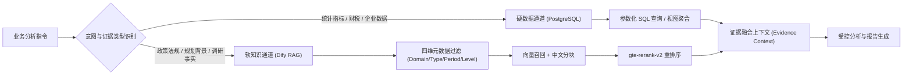

### 3.2 结构化底座：1952-2024 年鉴库与 22,119 家企业图谱建设
- **宏观统计年鉴库**：清洗导入 1952—2024 年全省统计数据，覆盖 925 个地区、970 张标准表、324,539 条结构化记录；
- **企业工商数据底座**：清洗入库 21 个市州 22,119 家重点企业工商登记、行业分类与经营范围；
- **全省 183 县数据覆盖度矩阵**：建立 183 县 × 5 年指标覆盖矩阵（9,150 单元），精准识别各县数据缺口，自动派发《部门补数清单》。

### 3.3 知识工程：Dify 12 大专题知识库治理与 GraphRAG 混合检索
项目构建了 12 个专题知识库（收录 427 份核心文档，约 254 万字）：
- `KB-510283`（隆昌试点县专属资料库，136 份）
- `KB-POLICY-NATIONAL` / `KB-POLICY-PROVINCE`（国家/省级政策法规）
- `KB-INDUSTRY`（重点产业链规范与技术路线）
- `KB-MEETING`（政企调研纪要与现场访谈）
- `KB-SCHEMA`（数据库 206 张表结构定义与技术字典）等。

在建设过程中，团队实施了一系列高难度的知识工程治理：

#### 1) 多模态解析流水线
针对政府部门提供的扫描件 PDF、复杂红头文件、合并单元格 Excel：
- **MinerU**：负责复杂排版 PDF、图文混排及扫描件 OCR 识别；
- **MarkItDown**：处理标准 Word、PPT 及 HTML 文件转 Markdown；
- **Jina Reader**：抓取并抽取官方政策网页文本；
- **Pandas / Openpyxl**：专门拆解复杂 Excel 合并单元格，补齐层级维度后再行入库。

#### 2) 文档结构化重塑与分块优化（解决检索稀释）
- **政府工作报告分块治理**：原文档缺乏标准 Markdown Heading，Dify 原生层级分块退化为按字符粗暴截断，产生 ~2000 字超大文本块。团队编写预处理脚本，利用正则自动将中文层级标记（如“一、”“（一）”）转换为 `##` / `###` 标题，同时剥离尾部名词解释为独立附录。
  - *效果*：2025 年报告从 12 段（均长 1,855 字）优化为 23 段（均长 720 字），**>1,500 字超大段从 6 个降为 0**，语义召回精准度大幅跃升。
- **会议纪要噪音清洗与知识重建**：原录音转写稿充斥口语词（“嗯、啊、哈哈”）、时间戳和琐碎短句，检索召回率几乎为 0。开发专用清洗脚本，剔除噪音、合并自然段并提取高频经济实体关键词，以层级模型重新入库，**语义相似度从 0 提升至 0.67~0.75**。

#### 3) KB-SCHEMA 业务域表目录语义桥接（0 命中到 0.815 分）
面对 206 张数据库表结构文档，用户提问“隆昌 GDP 数据在哪个表”时，与纯技术 DDL 存在巨大的语义鸿沟。
团队构建了 5 个业务域语义索引文档（*经济GDP人口、工业企业科技、农业财政投资、商贸金融民生、县域综合速查*），建立从业务术语到物理数据表名的对齐映射，**表结构检索命中得分从 0 提升至 0.815**。

#### 4) 四维元数据过滤与混合检索落地
为 427 份文档批量打上结构化元数据：
- `domain`（宏观经济、工业经济、农业农村、财政金融等）
- `data_type`（统计公报、政府工作报告、政策法规、调研纪要等）
- `data_period`（年份标注）
- `level`（国家级、省级、市州级、县级）

检索时在 Dify 侧执行“前置元数据硬过滤 + 向量检索 + gte-rerank-v2 重排序”，彻底解决跨年份、跨地域检索串扰问题。

#### 5) Contextual Retrieval：上下文增强切片前缀工程（彻底攻克代词孤立）
传统切片直接将切分后的文本块转为向量，导致切片严重脱离父文档层级。在政务材料中，大量出现“我市”、“该主导产业”、“上述重点工程”等代词或省略主语，一旦被孤立切开，向量检索极易出现“张冠李戴”的致命串扰。
系统在离线解析流水线中引入 Contextual Retrieval：利用轻量模型为每个原子 Chunk 预先生成 50~100 字的**全局层级与主题定位前缀（Context Prefix）**：
```
[文档上下文定位前缀]: 本段属于《隆昌市制造业高质量发展规划(2021-2025)》第三章第二节玻陶产业，论述重点耐火材料与日用陶瓷向特种工业陶瓷转型的技改支持政策
[原始正文内容]: 为鼓励上述骨干企业实施窑炉智能化改造，市财政按设备投资额的 15% 给予专项奖补，单个项目最高不超过 300 万元...
```
将前缀与原始正文拼接后再计算 Embedding 与构建 BM25 索引。即使原文只有“上述骨干企业”，向量空间也能精准捕捉其属于“隆昌市玻陶产业特种陶瓷企业”，检索召回率提升显著，且**线上检索耗时零增加**。

#### 6) GraphRAG：产业链实体知识图谱与双路径分层检索（解决多跳断裂与宏观归纳失效）
面对复杂的产业链错位发展研判，传统向量检索暴露出两大根本性缺陷：
- **多跳关系断裂（Multi-hop Disconnect）**：无法穿透“玻陶龙头企业 → 紧缺高纯石英砂原材料 → 跨县供货依赖（宜宾珙县） → 铁路货运场站吞吐瓶颈”等多跳依赖；
- **宏观归纳失效（Global Blindness）**：面对“隆昌市主导产业发展的全局战略总定位与十五五转型主线是什么”等高层提问，自底向上的切片检索只能召回零星细节片段，“只见树木不见森林”。

系统构建了 **GraphRAG 双路径知识拓扑检索中枢**：
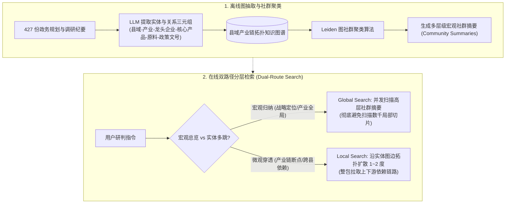

- **Global Search（全局宏观路径）**：直接在 Leiden 算法聚类生成的预计算社群摘要上并发扫描，耗费极少 Token 即可输出高屋建瓴的全局战略归纳；
- **Local Search（局部拓扑扩散路径）**：从用户问题中识别核心产业/企业种子实体，沿知识图谱边向外扩散跳跃 1~2 度，整包提取包含关联实体、供求依赖及政策约束的拓扑子图，实现对产业链卡脖子断点的精准穿透。

#### 7) RRF 倒数排名融合算法（Reciprocal Rank Fusion）
生产级检索绝不单独依赖密集向量（Dense Vector），系统构建了 Dense Vector 与 Sparse BM25（对公文文号、企业统一社会信用代码、统计指标代码精确匹配）双路并发召回，并落地 **RRF 倒数排名融合算法**：
$$\text{RRF Score}(d) = \sum_{m \in \{\text{Vector}, \text{BM25}\}} \frac{1}{60 + r_m(d)}$$
其中平滑参数 $k=60$。RRF 彻底抹平了余弦相似度（$0\sim 1$）与 BM25 分值（无界）之间的量纲鸿沟，将双路召回的 Top-50 结果按相对名次归一化对齐，粗排筛选 Top-30 后送入 `gte-rerank-v2` 交叉编码器精排，最终锁定 Top-5 黄金证据注入 Agent 上下文。

### 3.4 记忆架构：Working/Episodic/Semantic/Procedural 四层体系
大模型本身没有任何跨任务长效状态。为了让系统在处理跨年度、跨部门的复杂研判任务时保持上下文一致与历史溯源，系统将所有异构存储介质映射为标准的**四层分层记忆模型**：

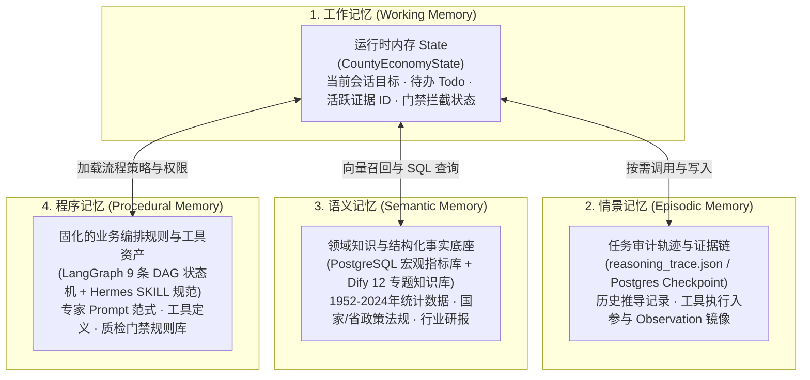

| 记忆分层 | 系统物理存储载体 | 存活生命周期 | 访问机制与协议 | 在县域经济业务中的核心用途 |
|---|---|---|---|---|
| **工作记忆 (Working Memory)** | 内存字典 / LangGraph 进程运行栈 | 单次任务会话周期 | 全局状态 `CountyEconomyState` 随步骤自动流转 | 维护当前分析任务目标、步骤进展（`todo_list`）、当前活跃引用的证据句柄。 |
| **情景记忆 (Episodic Memory)** | PostgreSQL 状态表 / `reasoning_trace.json` | 长期持久化 | 按 `thread_id` 或 `task_id` 精确检索历史回放 | 记录单次报告推演的完整审计线索，支持断点恢复续跑与专家人工复审时的证据溯源。 |
| **语义记忆 (Semantic Memory)** | PostgreSQL (硬数据) + Dify 向量库 (软知识) | 永久保存与定时更新 | SQL 参数化查询 + 四维元数据混合向量检索 | 承载 32.4 万年鉴指标、2.2 万企业库、427 份政策与调研文件，为所有决策提供坚实的事实底座。 |
| **程序记忆 (Procedural Memory)** | Python 代码仓库 / Hermes `SKILL.md` / MCP 配置 | 代码版本化受控管理 | 按业务链 `workflow_id` 自动加载对应 DAG 与角色 | 固化 9 条业务链 SOP、16 个角色的审查规范、区位商公式和 6 层门禁校验逻辑。 |

通过这种严格的四层记忆映射，系统杜绝了“把所有东西都往 Prompt 里塞”的工程坏习惯，实现了**工作上下文轻量化、长期事实结构化、业务 SOP 代码化**的架构标准。

### 3.5 数据形态：五层数据形态解耦与 RAG vs Memory 本质分界
在政务复杂 Agent 系统中，“消息历史”、“工作上下文”、“业务状态”、“长期记忆”与“外部知识”极易被混为一谈。系统确立了清晰的五层数据形态解耦架构：

```mermaid
flowchart TD
  subgraph StorageTier["1. 持久化存储层 (Persistent Storage Tier)"]
    D_RAG[("Dify 向量库 / 全文索引\n【RAG 外部知识】")]
    D_Mem[("Postgres KV / 经验图谱\n【Memory 长期记忆】")]
    D_State[("PostgreSQL 状态表 / Redis\n【State 强类型状态机】")]
  end

  subgraph ContextEngine["2. 上下文工作集编排引擎 (Context Engine)"]
    D_RAG -->|"只读检索切片"| Ctx["Context 瞬时工作集\n(Prompt + State + Docs + TrimmedMsgs)"]
    D_Mem -->|"沉淀经验与偏好注入"| Ctx
    D_State -->|"实时进度与待办注入"| Ctx
    Msgs["Messages 原始协议历史\n(role + content 原始日志)"] -->|"原子组安全修剪"| Ctx
  end

  subgraph InferenceTier["3. 推理执行层 (Inference Tier)"]
    Ctx -->|"单次 POST 瞬时计算"| LLM["大语言模型 (Inference)"]
    LLM -->|"tool_calls 声明"| Harness["Agent Harness 宿主"]
    Harness -->|"步进更新"| D_State
    Harness -->|"追加原样消息"| Msgs
  end
```

| 数据形态 | 物理存储载体 | 存活生命周期 | 核心系统职责 | 读写特性与访问机制 |
|---|---|---|---|---|
| **Messages (原始消息)** | 关系型数据库 / 日志服务 | 单次会话生命周期 | 严格遵守大模型协议的原样交互历史（`role` + `content` + `tool_calls`）。 | 高频只追加写入，不可随意物理切片断开。 |
| **Context (工作上下文)** | 模型显存 / 推理内存 | 单次推理（毫秒级） | **为当前步骤定向装配的 Token 瞬时计算集**：系统指令 + 状态快照 + 检索切片 + 裁剪消息 + 工具清单。 | 推理结束后立即销毁，不承载持久状态。 |
| **State (系统状态机)** | PostgreSQL / Redis / 磁盘 | 任务全流程（小时至天） | **业务系统的一等公民**：强类型结构体，显式记录任务阶段、完成步骤、待办清单、已验证事实与重试计数。 | 步进强读写，支持 OOM 重启后断点 Resume。 |
| **Memory (长期记忆)** | 向量数据库 / 经验图谱 | 跨会话、跨任务永久存续 | 沉淀智能体自身的**执行经验、专家修正习惯、复盘反思心得**（如某类指标的常见口径陷阱）。 | 运行时动态提炼，任务终结后异步写入，新任务按相似度召回。 |
| **RAG (外部知识检索)** | Dify 知识库 / 外部文件 | 外部业务数据生命周期 | 为系统补充未曾在模型权重中包含的私有公文、政策法规、统计标准切片。 | **高频只读**，由数据中台和离线流水线维护，不随对话产生副作用。 |

#### RAG 与 Memory 的本质分界表：
- **知识源属性**：RAG 属于外部客观世界的公用静态资料（如《隆昌市国民经济和社会发展十四五规划纲要》）；Memory 属于智能体在解决历史任务中自身沉淀的主观经验心得（如“处理隆昌统计局 Excel 时，规上工增数据在附表 3 需特殊解析”）；
- **执行副作用**：RAG 召回失败只会导致信息缺失，不改变系统控制流程；Memory 若召回错误经验可能导致模型继承历史错误偏好。因此系统确立**“业务事实以 RAG 和 SQL 为准，操作方法参考 Memory”**的硬性铁律。

### 3.6 上下文工程：五层组装结构、状态栏注入与渐进式技能挂载

在处理严肃政务长程任务时，静态 Prompt 能解决的问题非常局限。同一个大模型，若仅输入单句指令“请评估隆昌装备制造业发展瓶颈”，往往只会产出宽泛套话；而如果在单步推理前为其动态装配了当前区县行政区划、真实系统年份、已消耗的步数水表、细分行业诊断 SOP、已确认的硬指标底表及近 3 轮裁剪轨迹，模型能精准输出穿透统计数据的专业洞见。
系统将大模型的单次推理输入作为**动态信息供给链**，构建了工业级 Context Engineering 体系：

#### 1. 概念升维：从 Prompt Engineering 到 Context Engineering
| 维度 | Prompt Engineering（静态提示词工程） | Context Engineering（动态上下文工程） |
| :--- | :--- | :--- |
| **关注范畴** | 单次调用的自然语言文本（措辞、语气、Few-shot 样例） | 支撑整个决策生命周期的**动态数据供给流水线** |
| **数据属性** | 静态为主，通常在代码中硬编码或配置于模板中心 | 高度动态，根据当前运行期状态、外部环境与权限实时计算装配 |
| **核心挑战** | 词不达意、模型不听指令 | **注意力稀释（Attention Dilution）、Prompt Cache 失效、信息信噪比失衡** |

#### 2. 生产级上下文的五层黄金结构（Top-Down Assembly）
```mermaid
flowchart TD
  subgraph ContextPipeline ["动态上下文装配流 (Top-Down Assembly)"]
    L1["Layer 1: 核心身份与安全基线 (Core Persona & Safety Anchors)<br/>【固定在最顶部，永远不被裁剪，保障 KV Cache 命中】"]
    L2["Layer 2: 运行时环境状态栏 (Runtime Environment Metadata)<br/>【真实时间戳、行政区划、步数水表 step_used: 4/6、Token 水位】"]
    L3["Layer 3: 渐进式技能文档 (Progressive Skills Disclosure)<br/>【按需动态水合挂载的细分行业 SOP 与专属规程】"]
    L4["Layer 4: 结构化状态机与已确认事实 (Active State & Facts)<br/>【当前子目标、已确认硬指标底表、已完成里程碑】"]
    L5["Layer 5: 近期工作轨迹与观测数据 (Working Trace & Observations)<br/>【近 3 轮清洗修剪后的工具调用结果，老 Observation 折叠】"]
  end
  L1 --> L2 --> L3 --> L4 --> L5
```

- **Layer 1 绝对不可变（KV-Cache 极速命中）**：
  将最核心的政务发改委专家身份、三大红线（不替代法定统计、不直接定性排名、涉密脱敏）牢牢锚定在 Layer 1 顶部，坚决禁止在此处注入任何动态时间或动态变量，保证大模型供应商的 Prompt Cache 命中率维持在 $90\%$ 以上，大幅降低 TTFT 延迟与 Token 账单；
- **Layer 2 运行时状态栏注入（Status Line）**：
  大语言模型原生缺乏对现实物理时间的感知，也无法感知外部调度器的预算消耗。系统在 Layer 2 动态注入紧凑的 XML 环境元数据：
  ```xml
  <runtime_environment>
    <current_time>2026-10-09T01:15:00+08:00</current_time>
    <county_context code="510283" name="隆昌市" level="县级市" />
    <budget_meter step_used="4" max_steps="6" tokens_consumed="38500" max_tokens="80000" />
  </runtime_environment>
  ```
  当模型在输入中明确感知到 `step_used: 5 / 6` 时，会产生强烈的**预算压迫感与目标收敛意识**，主动放弃无序的工具探索，倾向于尽快聚合已有事实输出最终成果；
- **Layer 3 渐进式技能披露（Progressive Skills Disclosure）**：
  严禁将 16 个专家角色涉及的全部行业规章和发改委公文规范全量塞入 System Prompt。初始状态下仅下发技能索引目录；只有当模型分析明确需要时，才触发二级工具动态水合加载详细的 `SKILL.md`（如玻陶产业诊断 SOP、重点工程策划标准），实现工作集的按需最小化与上下文信噪比最大化；
- **U 型注意力衰减治理与尾部再锚定（Tail Recency Anchoring）**：
  针对 Transformer 模型的“中间迷失（Lost in the Middle）”效应，系统对中段超过 3 轮的历史工具 Observation 实施摘要折叠，并在发送给模型的 `messages` 最后一项重新追加简明扼要的当前任务强调指令（例如：`【决策要求】：请依据上述已确认统计底表，输出结构化章节草案并退出`），充分利用注意力的尾部近因效应锁定执行结果。

---

## 4. 9 条业务链流水线全景剖析与流程图详解

系统将县域经济研判涉及的繁杂业务梳理并固化为 9 条标准业务链（Workflow）。所有业务链由 `CountyEconomyState` 共享状态驱动，遵循**“输入参数校验 -> 角色分派 -> 确定性工具调用 -> LLM分析提炼 -> 质量门禁校验 -> 结构化产物落地”**的标准范式。

---

### 4.1 业务链 01：数据治理与基础普查流水线 (`data_governance`)
- **业务定位**：全面摸排县域数据底数，核查 183 县在多源部门的数据归集度、口径一致性与缺失度，生成数据资产清单并派发补数任务。
- **触发短语**：`数据治理`、`指标体系`、`基础普查`、`数据质量`、`缺数补数`、`数据资产`
- **输入参数**：必填 `county_code`（6位区划码）、`period`（年份）；选填 `dataset_scope`、`metric_scope`
- **协同角色**：首席经济专家 (`chief_economist`)、数据治理专家 (`data_steward`)、报告主编 (`report_editor`)
- **依赖工具**：`query_metrics`、`check_data_quality`、`summary_structured`、`build_data_asset_inventory`
- **交付产物**：
  - `data_governance_report.md`（县域数据质量诊断报告）
  - `data_asset_inventory.json`（县域数据资产目录）
  - `missing_metric_tasks.json`（部门补数工单与追溯清单）
- **复核策略**：`required_before_department_circulation`（向省/市/县部门流转补数工单前必须人工核验确认）

```mermaid
flowchart TD
  Start(["输入：county_code, period"]) --> V1["参数与权限校验"]
  V1 --> Query["调用 query_metrics 扫描 183 县覆盖度矩阵"]
  Query --> Check["调用 check_data_quality 执行一致性/完整性校验"]
  Check --> Classify{"发现指标缺失或异常？"}
  Classify -->|是| TaskGen["生成 missing_metric_tasks 补数清单\n标记责任部门与缺失年份"]
  Classify -->|否| AllGood["标记数据就绪状态 ready"]
  TaskGen --> BuildInv["调用 build_data_asset_inventory\n编目资产字典"]
  AllGood --> BuildInv
  BuildInv --> GenRep["data_steward 汇总撰写数据治理诊断报告"]
  GenRep --> Gate{"数据门禁审查"}
  Gate -->|通过| Output(["输出：治理报告 + 资产目录 + 补数清单"])
  Gate -->|未通过| Review(["挂起人工复核 / needs_human_review"])
```

---

### 4.2 业务链 02：运行态势综合研判流水线 (`monitoring_report`)
- **业务定位**：自动提取 GDP、固定资产投资、财税收支、工业增长等宏观总量，进行同比环比、位次排名与多维横向对标，触发红黄绿预警信号并生成监测报告。
- **触发短语**：`运行态势`、`经济运行`、`监测报告`、`预警`、`横向对比`
- **输入参数**：必填 `county_code`、`period`；选填 `compare_group`（对标区县组）、`metric_scope`
- **协同角色**：首席经济专家、数据治理专家、运行监测分析师 (`monitoring_analyst`)、预警分析师 (`warning_analyst`)、报告主编
- **依赖工具**：`query_metrics`、`check_data_quality`、`summary_county`、`compare_counties`、`generate_warnings`、`generate_monitoring_report`
- **交付产物**：
  - `monitoring_report.md`（综合运行监测报告）
  - `warning_list.json`（红黄绿分级预警台账）
  - `data_quality_summary.json`（指标质量摘要）
- **复核策略**：`required_when_low_confidence_or_public_release`（置信度偏低或对外正式发布前必须人工复核）

```mermaid
flowchart TD
  Start(["输入：county_code, period, compare_group"]) --> Query["从 PostgreSQL 查询核心宏观经济指标"]
  Query --> CompCounty["调用 summary_county 汇总指标表现\n调用 compare_counties 横向对标周边区县"]
  CompCounty --> WarnEng["调用 generate_warnings\n根据统计偏离度触发红/黄/绿预警"]
  WarnEng --> AnaRole["monitoring_analyst 提炼运行态势摘要\nwarning_analyst 形成预警成因分析"]
  AnaRole --> Draft["生成 monitoring_report.md 草案"]
  Draft --> NumGate{"数字门禁校验\n(所有数字是否源于 PG 并标明口径？)"}
  NumGate -->|未通过| Patch["打回修正指标数字引用"]
  Patch --> Draft
  NumGate -->|通过| EndGate{"敏感与发布门禁"}
  EndGate -->|通过| Output(["输出：运行监测报告 + 预警台账"])
  EndGate -->|存在风险| Review(["挂起待审"])
```

---

### 4.3 业务链 03：产业精准画像与比较优势分析流水线 (`industry_diagnosis`)
- **业务定位**：基于五维指标体系（规模、成长性、创新性、带动性、绿色化）对县域重点产业进行深度画像，测算产业区位商（LQ），量化主导产业与同质化竞争风险。
- **触发短语**：`产业画像`、`比较优势`、`主导产业`、`产业诊断`、`同质化`
- **输入参数**：必填 `county_code`、`period`；选填 `industry_line`（特定产业赛道）、`compare_group`
- **协同角色**：首席经济专家、产业战略分析师 (`industry_strategist`)、产业链分析师 (`chain_analyst`)、报告主编
- **依赖工具**：`query_enterprises`、`query_industry_metrics`、`query_projects`、`query_expert_rules`、`search_evidence`
- **交付产物**：
  - `industry_diagnosis.md`（主导产业精准诊断报告）
  - `advantage_boundary.json`（产业比较优势边界矩阵）
  - `evidence_gaps.json`（佐证数据缺口清单）
- **复核策略**：`required_for_advantage_claims`（凡做出“具备显著比较优势”的强判断必须由专家最终背书）

```mermaid
flowchart TD
  Start(["输入：county_code, period, industry_line"]) --> FetchData["并发查询：\n1. 企业工商库 (query_enterprises)\n2. 规上工业指标 (query_industry_metrics)\n3. 重点产业项目 (query_projects)"]
  FetchData --> LQCalc["测算五维指标与产业区位商 (LQ)\n识别特色集聚赛道 vs 趋同赛道"]
  LQCalc --> DifyRAG["Dify 检索：全省产业规划与该产业技术路线图"]
  DifyRAG --> Strategist["industry_strategist 产出比较优势边界\nchain_analyst 标注关键龙头与断链环节"]
  Strategist --> Draft["生成 industry_diagnosis.md 草稿"]
  Draft --> LogicGate{"因果与证据门禁校验\n(是否存在样本外推？优势证据是否充分？)"}
  LogicGate -->|证据薄弱| Downgrade["降级为待核验线索，写入 evidence_gaps"]
  Downgrade --> Assembly
  LogicGate -->|证据充分| Assembly["组装诊断报告与优势边界矩阵"]
  Assembly --> Output(["输出：产业诊断报告 + 优势边界 + 证据缺口"])
```

---

### 4.4 业务链 04：县域发展瓶颈归因流水线 (`bottleneck_analysis`)
- **业务定位**：将上游的运行监测预警信号和产业短板进行交叉比对，结合土地、能耗、资金、人才等要素约束，提炼“待核验瓶颈假设”与实地调研任务。
- **触发短语**：`瓶颈`、`归因`、`短板`、`制约`、`资源要素`
- **输入参数**：必填 `county_code`、`period`；选填 `focus_area`（特定瓶颈领域）
- **协同角色**：首席经济专家、瓶颈诊断专家 (`bottleneck_diagnostician`)、要素资源分析师 (`factor_resource_analyst`)、报告主编
- **依赖工具**：`query_metrics`、`query_projects`、`query_industry_metrics`、`query_factor_constraints`、`search_evidence`、`query_expert_rules`
- **交付产物**：
  - `bottleneck_report.md`（县域发展瓶颈归因诊断报告）
  - `hypotheses.json`（结构化待核验瓶颈假设集合）
  - `verification_tasks.json`（线下实地核验任务清单）
- **复核策略**：`required_for_causal_claims`（严格禁止未经核验的因果性定性结论）

```mermaid
flowchart TD
  Start(["输入：county_code, period, focus_area"]) --> LoadUpstream["加载前置产物：\n运行预警列表 + 产业短板记录"]
  LoadUpstream --> QueryFactor["调用 query_factor_constraints 查询：\n用地指标、环境承载、财政负债、人才缺口"]
  QueryFactor --> DiagRole["bottleneck_diagnostician 构建因果推导树\nfactor_resource_analyst 输出要素制约矩阵"]
  DiagRole --> BuildHyp["生成 hypotheses (结构化瓶颈假设)\n生成 verification_tasks (线下核查清单)"]
  BuildHyp --> StrictGate{"强逻辑审查门禁\n(是否将相关性表述为确定性因果？)"}
  StrictGate -->|违规因果词| ForcePatch["强行重写为：『显示存在...倾向，需核验』"]
  ForcePatch --> RepGen
  StrictGate -->|合规| RepGen["生成 bottleneck_report.md"]
  RepGen --> Output(["输出：瓶颈归因报告 + 待核验假设 + 验证任务"])
```

---

### 4.5 业务链 05：政策需求梳理与行动匹配流水线 (`policy_decision`)
- **业务定位**：基于前序运行预警与瓶颈分析成果，检索国家、省、市最新出台的产业扶持政策，梳理政策兑现堵点，生成精准匹配的《政策行动建议矩阵》。
- **触发短语**：`政策需求`、`政策匹配`、`政策依据`、`政策矩阵`、`政策实施`、`动态优化`
- **输入参数**：必填 `county_code`、`period`；选填 `policy_scope`、`target_problem`
- **协同角色**：首席经济专家、政策规划专家 (`policy_planner`)、报告主编
- **依赖工具**：`load_monitoring_summary`、`load_industry_diagnosis`、`load_bottleneck_analysis`、`search_policy`、`build_policy_action_matrix`
- **交付产物**：
  - `policy_decision_report.md`（政策梳理与落地建议报告）
  - `policy_action_matrix.json`（政策行动建议矩阵：含责任部门、政策文号与支持路径）
  - `policy_needs.json`（对上争取支持的政策需求诉求清单）
- **复核策略**：`required_before_policy_circulation`（政策矩阵正式呈送政府常务会或发文流转前必须经过法制与业务处室审核）

```mermaid
flowchart TD
  Start(["输入：county_code, period, target_problem"]) --> LoadAnalysis["集成上游分析包：\n监测态势 + 产业画像 + 瓶颈短板"]
  LoadAnalysis --> SearchPolicy["调用 search_policy 在 Dify 检索：\n国家/省级专项扶持政策与申报指南 (含文号)"]
  SearchPolicy --> PolicyPlanner["policy_planner 逐项匹配问题与政策抓手\n判定适用条件与对上争取空间"]
  PolicyPlanner --> MatrixBuild["调用 build_policy_action_matrix 构造矩阵：\n问题 -> 对应政策 -> 实施举措 -> 牵头部门"]
  MatrixBuild --> PolicyGate{"政策真实性门禁\n(政策文号是否真实？是否越权承诺资金补贴？)"}
  PolicyGate -->|虚假文号或夸大承诺| Reject["拦截并要求重新检索确切政策条文"]
  Reject --> SearchPolicy
  PolicyGate -->|真实合规| FinalDoc["生成 policy_decision_report.md"]
  FinalDoc --> Output(["输出：政策建议报告 + 行动矩阵 + 向上争取清单"])
```

---

### 4.6 业务链 06：一县一策思路与规划编制流水线 (`one_county_one_policy_outline`)
- **业务定位**：县域顶层设计主链。将监测数据、产业优势、瓶颈制约与政策矩阵汇聚为规划底包，通过规划专家 Subagent 协同编排生成完整的《一县一策综合赋能规划方案》及 Word 送审稿。
- **触发短语**：`一县一策`、`赋能方案`、`规划框架`、`总体思路`、`实施方案`
- **输入参数**：必填 `county_code`、`period`；选填 `deliverable_type`、`planning_scope`
- **协同角色**：首席经济专家、政策规划专家、县域规划总师 (`county_planning_chief`)、规划审查专家 (`planning_quality_reviewer`)
- **依赖工具**：`load_monitoring_summary`、`load_industry_diagnosis`、`load_bottleneck_analysis`、`search_policy`、`dispatch_county_planner`
- **交付产物**：
  - `one_county_one_policy_outline.md`（一县一策框架大纲）
  - `planning_framework_v02.docx`（一县一策完整公文 Word 送审稿）
  - `planning_quality_review.json`（规划质量审查与合规评估表）
- **复核策略**：`required_before_full_plan_generation`（方案框架必须经专家审签后方可展开撰写完整方案）

```mermaid
flowchart TD
  Start(["输入：county_code, period, planning_scope"]) --> PackContext["组装全量上游分析上下文包\n(宏观指标+优势赛道+瓶颈假设+政策矩阵)"]
  PackContext --> DispatchChief["county_planning_chief 设定规划总体定位与发展主线\n确立『一县一策』骨架大纲"]
  DispatchChief --> SubTaskGen["生成章节写作任务包\n(第一章发展基础 / 第二章总体要求 / 第三章重点任务...)"]
  SubTaskGen --> SubagentWrite["调用 dispatch_county_planner (规划 Subagents 并行协同撰写)"]
  SubagentWrite --> Assemble["汇总组装长篇规划初稿"]
  Assemble --> PlanReview["planning_quality_reviewer 启动专项审查：\n1. 结构完整度 2. 证据追溯 3. 越权定性 4. 样本机械照搬"]
  PlanReview --> Score{"审查得分是否通过？"}
  Score -->|否: 存在越权或无依据表述| FixTask["生成章节修订补丁任务"]
  FixTask --> SubagentWrite
  Score -->|通过| DocxRender["调用 Pandoc/Docx 导出为标准公文格式"]
  DocxRender --> Output(["输出：规划方案大纲 + Word 送审稿 + 质检报告"])
```

---

### 4.7 业务链 07：基于产业链断点的精准招商流水线 (`project_investment`)
- **业务定位**：从产业诊断中的产业链缺失环节（断链、卡脖子环节）逆向倒推，结合重点项目要素保障能力，筛选目标招商赛道，生成可落地的《精准招商方向与要素协同服务清单》。
- **触发短语**：`招商`、`项目筛选`、`产业链短板`、`补链`、`落地服务`
- **输入参数**：必填 `county_code`、`period`；选填 `industry_line`、`project_stage`
- **协同角色**：首席经济专家、产业链分析师、项目招商分析师 (`project_investment_agent`)、落地协同专员 (`landing_service_agent`)、报告主编
- **依赖工具**：`query_chain_gaps`、`query_projects`、`query_enterprises`、`query_factor_constraints`、`search_evidence`
- **交付产物**：
  - `investment_opportunity_list.json`（产业链靶向招商机会清单）
  - `landing_service_list.json`（招商项目落地协同与要素保障任务单）
  - `project_report.md`（县域重大项目投资分析报告）
- **复核策略**：`required_for_project_prioritization`（生成任何对外招商优先排序前必须通过发改/招商部门联合确认）

```mermaid
flowchart TD
  Start(["输入：county_code, period, industry_line"]) --> ChainGap["调用 query_chain_gaps 梳理产业链断点与薄弱环节"]
  ChainGap --> TargetMatch["query_enterprises 匹配省内外上下游链主与配套企业样本"]
  TargetMatch --> InvestAgent["project_investment_agent 制定延链补链招商方向"]
  InvestAgent --> FactorCheck["landing_service_agent 联动 query_factor_constraints\n核验土地/能耗/环保指标承载力"]
  FactorCheck --> BuildService["生成落地协同任务清单 (土地出让/环评审批/电价扶持)"]
  BuildService --> InvestGate{"招商合规审查门禁\n(严禁承诺未经审批的土地/税收倾斜政策)"}
  InvestGate -->|违规承诺| PatchService["剥离违规承诺，限定为『合规服务流程』"]
  PatchService --> Output
  InvestGate -->|合规| Output(["输出：招商机会清单 + 落地服务工单 + 投资分析报告"])
```

---

### 4.8 业务链 08：统计分析与计量经济学研判流水线 (`model_analysis`)
- **业务定位**：面向严谨的经济学量化分析需求。集成因果推断（DID/PSM）、面板分析、空间计量与预测预警模型，前置设置严格的“识别条件检验门禁”，防止伪科学因果结论。
- **触发短语**：`模型分析`、`计量模型`、`统计分析`、`综合评价`、`聚类`、`预测`
- **输入参数**：必填 `county_code`、`period`；选填 `model_family_id`、`model_method`、`target_metric`、`feature_metrics`、`treatment_field`、`policy_time`、`spatial_data_path`
- **协同角色**：首席经济专家、数据治理专家、量化模型分析师 (`quant_model_analyst`)、报告主编
- **依赖工具**：`route_model_family`、`load_model_dataset`、`evaluate_model_readiness`、`execute_model_family`
- **交付产物**：
  - `model_analysis_report.md`（计量模型分析与检验报告）
  - `model_analysis_result.json`（模型回归系数、置信区间与检验值）
  - `model_execution_metadata.json`（模型输入参数与环境运行记录）
- **复核策略**：`required_when_blocked_or_needs_data`（数据条件不满足时阻断执行并转入补数任务）

```mermaid
flowchart TD
  Start(["输入：county_code, period, model_family_id, treatment_field..."]) --> Route["调用 route_model_family 匹配模型族\n(如 DID因果推断 / 综合评价 / 空间滞后)"]
  Route --> LoadData["调用 load_model_dataset 提取面板数据"]
  LoadData --> ReadinessGate{"调用 evaluate_model_readiness\n检验前置假设：\n平行趋势检验？样本量足够？控制变量齐全？"}
  ReadinessGate -->|条件不满足| Blocked["状态置为 blocked / needs_data\n输出《数据不足说明》与补数建议，终止运行"]
  ReadinessGate -->|满足识别条件| Execute["调用 execute_model_family 执行回归测算"]
  Execute --> QuantRole["quant_model_analyst 解释模型系数与统计显著性\n严格限定解释边界 (仅说明净效应估算值)"]
  QuantRole --> RepGen["生成 model_analysis_report.md"]
  RepGen --> Output(["输出：模型分析报告 + 回归系数 JSON"])
```

---

### 4.9 业务链 09：县域体制运作逻辑与协同堵点研判流水线 (`governance_knowledge`)
- **业务定位**：从基层真实体制运转、财政财权事权、跨部门利益协同与考核指挥棒的视角，深度解析一个县域经济现象“为何产生”、“如何破解”，提供接地气的体制机制建议。
- **触发短语**：`县域运转`、`治理逻辑`、`真实逻辑`、`运转逻辑`、`县域经济与治理`、`部门协同`、`真实运转`
- **输入参数**：必填 `county_code`、`period`；选填 `focus_area`、`mechanism_scope`
- **协同角色**：首席经济专家、治理机制分析师 (`governance_knowledge_analyst`)、政策规划专家、报告主编
- **依赖工具**：`match_governance_mechanisms`、`synthesize_governance_knowledge`、`render_governance_knowledge_report`
- **交付产物**：
  - `governance_knowledge_report.md`（县域经济与真实治理机制研判报告）
  - `governance_knowledge_result.json`（匹配的治理运转机制关系图谱与部门协作映射）
- **复核策略**：`required_before_policy_or_governance_circulation`（涉及部门权责与体制改革表述必须严格人工核验）

```mermaid
flowchart TD
  Start(["输入：county_code, period, focus_area"]) --> LoadProblem["加载待解析的县域难题\n(如财政吃紧、项目落地慢、部门推诿等)"]
  LoadProblem --> MatchMech["调用 match_governance_mechanisms 匹配治理机制：\n财权事权划分、考核激励、垂直管辖与属地责任"]
  MatchMech --> KnowledgeSyn["调用 synthesize_governance_knowledge\n解析跨部门博弈与堵点成因"]
  KnowledgeSyn --> GovAnalyst["governance_knowledge_analyst 输出现实可行的协同方案\n(如专班推进机制、飞地园区利益分享机制)"]
  GovAnalyst --> GovGate{"行政权责审查门禁\n(是否符合当前法治与政府职能配置？)"}
  GovGate -->|不合规表述| PatchGov["修正表述，恪守行政法权边界"]
  PatchGov --> Render
  GovGate -->|合规| Render["render_governance_knowledge_report"]
  Render --> Output(["输出：治理逻辑研判报告 + 部门协作协同图谱"])
```

---

## 5. 16 个专家角色协同体系与边界规范详解

系统中的 16 个专家角色是**在 LangGraph 状态机中按工位装配的领域专家规范（Role Specification）**，不采用分散独立的聊天智能体形态。每个角色定义了专属的 System Prompt 提示词边界、授权工具集（Allowed Tools）以及负向约束红线。

```mermaid
classDiagram
  class BaseExpertRole {
    +str role_id
    +str name
    +List~str~ business_chains
    +List~str~ default_tools
    +List~str~ outputs
    +str confidence_policy
    +check_boundary()
  }

  class Macro_and_Governance {
    +chief_economist
    +governance_knowledge_analyst
    +factor_resource_analyst
  }

  class Data_and_Monitoring {
    +data_steward
    +monitoring_analyst
    +warning_analyst
    +quant_model_analyst
  }

  class Industry_and_Investment {
    +industry_strategist
    +chain_analyst
    +bottleneck_diagnostician
    +project_investment_agent
    +landing_service_agent
  }

  class Planning_and_Review {
    +policy_planner
    +county_planning_chief
    +planning_quality_reviewer
    +report_editor
  }

  BaseExpertRole <|-- Macro_and_Governance
  BaseExpertRole <|-- Data_and_Monitoring
  BaseExpertRole <|-- Industry_and_Investment
  BaseExpertRole <|-- Planning_and_Review
```

---

### 5.1 专家组 01：宏观经济与行政治理专家组（3 大角色）

#### 1. 县域经济首席专家 (`chief_economist`)
- **角色定位**：整个智能内核的统筹研判中枢，负责统一业务链判断基调、把控证据边界与最终对外交付口径。
- **协同业务链**：全链条协同（数据治理、运行监测、产业诊断、瓶颈归因、政策决策、规划、招商）。
- **授权工具集**：`query_metrics`、`search_evidence`、`query_expert_rules`
- **输入要求**：用户原始问题、业务链匹配上下文、各专家中间分析草案、证据卡与专家规则。
- **输出结构**：任务归属业务链、可支持结论、不可支持结论、需人工确认事项、最终交付物摘要 (`final_decision_brief`)。
- **判断边界与禁止表达**：
  - *严禁* 在未取得权威多源数据前断言“该县具备绝对比较优势”；
  - *严禁* 将政策出台与经济指标回升直接定性为因果关系；
  - *严禁* 规则版评分直接作为行政考核排名的结论。

#### 2. 县域治理知识分析师 (`governance_knowledge_analyst`)
- **角色定位**：负责把县域经济指标、项目、企业、财政、政策放入真实基层治理与行政运转链条中解释，剖析机制成因与跨部门协同堵点。
- **协同业务链**：县域治理知识链、运行监测链、瓶颈归因链、政策决策链、项目招商链。
- **授权工具集**：`match_governance_mechanisms`、`synthesize_governance_knowledge`、`render_governance_knowledge_report`
- **输入要求**：指标与项目线索、部门职能台账、本地治理机制字典。
- **输出结构**：匹配的治理机制、财政/产业/项目/审批链条深度解释、部门协同任务单、证据需求。
- **判断边界与禁止表达**：
  - *严禁* 将未经核实的基层线索直接当成行政问责事实；
  - *严禁* 越权建议设立未经法律法规授权的机构或审批事项。

#### 3. 要素资源约束分析师 (`factor_resource_analyst`)
- **角色定位**：专门分析土地、能耗、环境容量、财政资金、人才等硬要素承载力对经济发展的刚性制约。
- **协同业务链**：瓶颈归因链、项目招商链。
- **授权工具集**：`query_projects`、`query_factor_constraints`、`search_evidence`
- **输入要求**：项目要素需求清单、自然资源与生态环境指标、财政可支配财力。
- **输出结构**：要素约束清单、对应指标缺口、部门核验任务 (`factor_constraint_summary`)。
- **判断边界与禁止表达**：
  - 在未取得自然资源和发改部门正式核准前，不对单项用地或能耗指标作“完全受限、无法推进”的绝对死结论。

---

### 5.2 专家组 02：数据治理与量化监测专家组（4 大角色）

#### 4. 县域经济数据治理专员 (`data_steward`)
- **角色定位**：把守数据入口底座，核查指标来源、年份时效、统计口径与缺失度，确保只有合规数据流向下游分析。
- **协同业务链**：数据治理链、运行监测链、模型分析链。
- **授权工具集**：`check_data_quality`、`query_metrics`
- **输入要求**：待查县域、年份周期、指标范围、部门上报台账。
- **输出结构**：可用数据清单、数据缺口清单、口径风险提示、部门核验补数事项 (`data_quality_summary`)。
- **判断边界与禁止表达**：
  - *绝对禁止* 补造、猜测任何缺失指标数据；
  - 口径不一致的指标必须强制标注“不可直接对比”。

#### 5. 县域经济运行监测分析师 (`monitoring_analyst`)
- **角色定位**：基于硬指标数据库生成宏观运行态势摘要、横向同类县域对标与异动归因分析。
- **协同业务链**：运行监测链。
- **授权工具集**：`query_metrics`、`compare_counties`、`summary_county`
- **输入要求**：宏观指标集、历年同期基准、对标区县组。
- **输出结构**：运行态势摘要、核心指标升降表现、横向对比位次、需核验承压点。
- **判断边界与禁止表达**：
  - 只陈述指标客观表现，不替代统计部门进行官方数据核验定调；
  - 严禁从单个短期季度波动轻率推导出“经济全面下滑”等夸大性结论。

#### 6. 县域经济预警分析师 (`warning_analyst`)
- **角色定位**：基于设定的阈值模型触发红黄绿预警，解释预警成因，明确线下核查方向。
- **协同业务链**：运行监测链。
- **授权工具集**：`generate_warnings`、`query_expert_rules`
- **输入要求**：预警规则表、异动指标集合、历史波动阈值。
- **输出结构**：预警事项清单、触发依据说明、建议复核方向 (`warning_list`)。
- **判断边界与禁止表达**：
  - 预警仅代表“提示复核与风险隐患”，严禁表述为“风险已经发生或失控”。

#### 7. 统计与计量模型分析师 (`quant_model_analyst`)
- **角色定位**：负责计量模型与因果推断（DID/PSM/空间回归）的严谨算法选型、数据准备度检验与结果边界解释。
- **协同业务链**：模型分析链、运行监测链、瓶颈归因链。
- **授权工具集**：`route_model_family`、`evaluate_model_readiness`、`execute_model_family`
- **输入要求**：微观企业/项目面板数据、政策处理组对照组标签、空间拓扑权重。
- **输出结构**：模型族推荐、识别条件检验报告、回归测算结果、模型局限性说明。
- **判断边界与禁止表达**：
  - 平行趋势检验或样本量不满足时，*绝对阻断执行*，严禁输出未经检验的“因果净效应”结论。

---

### 5.3 专家组 03：产业诊断与招商协同专家组（5 大角色）

#### 8. 县域产业战略分析师 (`industry_strategist`)
- **角色定位**：运用区位商与五维指标体系绘制产业画像，研判主导优势、同质化赛道与错位发展方向。
- **协同业务链**：产业诊断链、一县一策与规划链。
- **授权工具集**：`query_industry_metrics`、`search_evidence`
- **输入要求**：产业增加值、企业集聚度、专利创新数、周边县域产业目录。
- **输出结构**：产业结构摘要、潜在比较优势边界、短板弱项说明 (`advantage_boundary`)。
- **判断边界与禁止表达**：
  - 企业样本调研数据不得直接代替全量产业规模；
  - 严禁在缺乏全省同口径横向比对前断言“全省领先”。

#### 9. 产业链关系分析师 (`chain_analyst`)
- **角色定位**：深入重点产业上下游，识别断链点、卡脖子环节、本地配套率不足与延链补链机会。
- **协同业务链**：产业诊断链、项目招商链。
- **授权工具集**：`query_chain_gaps`、`query_projects`、`query_enterprises`
- **输入要求**：产业链图谱、本地规上配套企业名录、重点在建项目。
- **输出结构**：产业链断点清单、关键链主与配套画像、招商补链切入点 (`chain_gap_summary`)。
- **判断边界与禁止表达**：
  - 单个企业的产能不足不能直接推断全县全产业链存在重大系统性缺陷。

#### 10. 县域瓶颈归因诊断师 (`bottleneck_diagnostician`)
- **角色定位**：连接监测预警与产业短板，将表象问题系统归因为“待核验瓶颈假设”。
- **协同业务链**：瓶颈归因链、一县一策与规划链。
- **授权工具集**：`query_metrics`、`search_evidence`、`query_expert_rules`
- **输入要求**：运行预警记录、产业诊断短板、要素瓶颈数据。
- **输出结构**：主要瓶颈假设、影响传导链条、实地核查任务清单 (`hypotheses`)。
- **判断边界与禁止表达**：
  - *绝对禁止* 将表象相关性直接判定为因果定性，所有结论必须以“假设”和“核查线索”形式输出。

#### 11. 项目招商机会分析师 (`project_investment_agent`)
- **角色定位**：结合产业链短板与要素禀赋，逆向推导靶向招商企业画像与重大产业项目机会。
- **协同业务链**：项目招商链。
- **授权工具集**：`query_projects`、`query_chain_gaps`、`search_evidence`
- **输入要求**：产业链短板清单、产业承载园区规划、外地龙头企业数据库。
- **输出结构**：招商机会方向库、目标企业画像、建议对接清单 (`investment_opportunity_list`)。
- **判断边界与禁止表达**：
  - 严禁擅自生成未经论证的招商项目优先级排序；严禁代替招商局进行正式可行性定论。

#### 12. 项目落地服务协同专员 (`landing_service_agent`)
- **角色定位**：把招商意向转化为用地、环评、能耗、审批等政务要素保障工单，梳理跨部门协同职责。
- **协同业务链**：项目招商链。
- **授权工具集**：`query_factor_constraints`、`query_projects`、`search_evidence`
- **输入要求**：招商意向项目清单、要素保障标准、政府各部门权责清单。
- **输出结构**：落地服务工单、要素协调责任表、审批时限监控表 (`landing_service_list`)。
- **判断边界与禁止表达**：
  - 严禁向项目方做出未经政府审批的排他性要素兜底承诺。

---

### 5.4 专家组 04：规划策划与质检统筹专家组（4 大角色）

#### 13. 一县一策政策策划专家 (`policy_planner`)
- **角色定位**：将县域瓶颈与产业需求精准映射到国家与省市扶持政策，形成政策争取与落地的抓手矩阵。
- **协同业务链**：政策决策链、一县一策与规划链。
- **授权工具集**：`search_policy`、`query_expert_rules`
- **输入要求**：瓶颈假设、主导产业诉求、Dify 政策法律法规知识库。
- **输出结构**：政策支持清单、政策行动建议矩阵、向上争取支持诉求单 (`policy_needs`)。
- **判断边界与禁止表达**：
  - *绝对严禁* 伪造、臆想政策文号或条款；严禁把研究建议表述为“上级已批复出台政策”。

#### 14. 一县一策与规划首席专家 (`county_planning_chief`)
- **角色定位**：统揽上游所有分析产物，编排一县一策方案总体思路、发展目标、章节架构与重点工程体系。
- **协同业务链**：一县一策与规划链。
- **授权工具集**：`dispatch_county_planner`、`search_policy`、`search_evidence`
- **输入要求**：县域全景分析包（监测+产业+瓶颈+政策+项目）。
- **输出结构**：县域战略定位、一县一策实施框架大纲、章节写作工单 (`planning_framework`)。
- **判断边界与禁止表达**：
  - 严禁将其他县的规划模板机械照搬到目标县；严禁将待核验假设作为既成事实写入规划背景。

#### 15. 规划质量与边界审查专家 (`planning_quality_reviewer`)
- **角色定位**：质量防线守门员，深度审查规划初稿是否存在数据无据、越权承诺、引文失真等合规缺陷。
- **协同业务链**：一县一策与规划链。
- **授权工具集**：`query_expert_rules`
- **输入要求**：规划草稿全文、上游分析证据链引用表、发改委公文规范标准。
- **输出结构**：质检打分项、问题拦截清单、章节修订补丁任务 (`planning_quality_review`)。
- **判断边界与禁止表达**：
  - 对任何未附带证据来源的强断言一律驳回；对模糊因果一律强制批注打回。

#### 16. 报告统稿与表达边界审查员 (`report_editor`)
- **角色定位**：负责全流程报告的公文格式统稿、图表排版美化、标点语病审查与最终表达边界修润。
- **协同业务链**：全链条通用产物导出。
- **授权工具集**：`query_expert_rules`
- **输入要求**：各业务链 Markdown 草稿、JSON 清单、样式规范。
- **输出结构**：标准 Word 送审稿、规范排版 Markdown 报告、边界审查记录 (`edited_report`)。
- **判断边界与禁止表达**：
  - 统一行文口吻：对未完全验证的事项规范使用“数据显示”、“建议进一步核实”等严谨政务公文修辞。

---

### 5.5 安全防线：从 Prompt 软约束到 Harness 代码硬拦截
在 Agent 系统设计中，最常见的工程误区之一是**“把安全、权限与停止条件写在 Prompt 里”**。
Prompt 本质上是对大模型的概率引导，无法提供 100% 确定性保证。即使在 16 个专家的 System Prompt 中写明了“严禁断言绝对优势”、“严禁推导因果”、“严禁越权承诺”，大模型在处理复杂长文本时仍可能发生偶发性突破。

因此，系统在工程上实行了**“Prompt 引导 + Harness 代码硬拦截”的双重防线**：

```mermaid
flowchart LR
  Prompt["1. System Prompt\n角色人格与业务指引 (软约束)"] --> LLMGen["2. 大模型生成候选输出"]
  LLMGen --> CodeGuard["3. Harness 代码拦截器\n(Deterministic Guardrails)"]
  
  subgraph Filters["代码级确定性检测与修正"]
    F1["正则强因果检测器\n(因果句式强转为假设)"]
    F2["数字溯源断言器\n(未绑定 PG ID 直接抹除)"]
    F3["政策文号查重校验\n(未命中白名单直接告警)"]
    F4["越权承诺语法扫描\n(承诺性动词强降级)"]
  end
  
  CodeGuard --> Filters
  Filters --> FinalOutput["4. 绝对受控的合规业务产物"]
```

1. **软约束（Prompt 层）**：让模型明确自身的专家视角与语境修辞，提高一次性生成合规内容的概率；
2. **硬拦截（Code/Harness 层）**：大模型的输出在落盘或传给下游前，必须通过 Python 代码层硬编码的过滤器：
   - **因果断言器**：检测句子中出现的“导致了、直接引起、证明了”等强因果词。若该句未绑定计量经济模型输出 ID，代码直接通过 AST 或正则重写为“提示存在关联，需实地核验”；
   - **文号白名单校验**：抓取“〔202X〕X号”等政策文号，与 Dify 政策库真实元数据比对，若未命中直接抛出异常；
   - **调用权限硬隔离**：角色允许调用的工具直接由代码配置的 `allowed_tools` 白名单强行绑定，模型即使在 Prompt 中被提示词注入或幻觉尝试发起未授权工具调用，Harness 直接在执行前抛出 `PermissionDeniedError`。

### 5.6 隔离真相：基于 Supervisor-Worker 的沙箱物理隔离
许多外行常将“16 个专家角色”误解为“在聊天室里开 16 个会话互相客套”。
本系统在工程架构上彻底破除这种拟人化噱头。在底层运行时中，**这 16 个角色本质上是由总调度中枢（Supervisor）按需激活的上下文隔离沙箱与权限投影（Context-Isolated Worker Sandbox）**：

```mermaid
flowchart TD
  subgraph SupervisorTier["总调度层 (Supervisor / CountyEconomyState)"]
    Sup["规划总师 / 运行总调度\n维护全局大纲里程碑 · 控制总状态机"]
  end

  subgraph WorkerSandboxes["隔离的 Worker 执行沙箱 (Context-Isolated Sandboxes)"]
    W1["产业战略专家沙箱 (Worker 1)\n【只注入: 玻陶/机械企业工商与区位商数据】\n独立处理 30k Tokens -> 产出 500字产业画像与边界"]
    W2["要素资源专家沙箱 (Worker 2)\n【只注入: 土地能耗环境承载力指标】\n独立处理 25k Tokens -> 产出 300字要素约束清单"]
    W3["招商补链专家沙箱 (Worker 3)\n【只注入: 省内外上下游企业名录与断点】\n独立处理 35k Tokens -> 产出 靶向招商项目库 JSON"]
  end

  Sup -->|"派发任务包 1"| W1
  Sup -->|"派发任务包 2"| W2
  Sup -->|"派发任务包 3"| W3

  W1 -->|"回传结构化摘要 (无原始日志污染)"| Sup
  W2 -->|"回传结构化摘要"| Sup
  W3 -->|"回传结构化 JSON"| Sup
```

#### 为什么必须采用多角色沙箱物理隔离？四大工程收益：
1. **彻底攻克 Lost in the Middle 上下文注意力溃散**：
   - 如果用单个 Agent 同时处理隆昌全县产业、土地、财政、项目等 1000+ 份资料，Prompt Tokens 瞬间飙升至 120k 以上，大模型必将在海量文字中“迷失在中间”，导致指标张冠李戴；
   - 拆分独立 Worker 沙箱后，每个角色只吞吐与其专长相关的 20~30k 切片，在干净的高信噪比上下文中精细研判，**最终仅向主状态回传提炼后的 500 字结论**，主状态体积始终稳定维持在几千 Tokens 的健康区间！
2. **并发扇出加速（Parallel Fan-out）**：
   - 多个领域的专家 Worker 通过 `asyncio.gather` 并发执行，将原本需串行运行 15 分钟的分析链压缩至最慢 Worker 的耗时（约 2 分钟）；
3. **数据权限最小特权原则（PoLP）**：
   - 例如只有 `data_steward` 拥有数据质量扫描工具，只有 `quant_model_analyst` 拥有计量模型执行工具，`report_editor` 没有任何数据库写权限，实现代码级的权限最小化暴露。

---

## 6. 分层质量门禁与事实契约体系（管住政务 AI 的表达边界）

在政务辅助决策场景中，**安全可信高于一切**。大模型若凭空捏造数据、虚假承诺招商政策或轻率得出因果归因结论，将引发严重行政风险。
在“工作流骨架嵌装智能体”的复合模式中，内层 Agent 节点的自适应探索必然伴随一定的模型输出随机性与幻觉风险。因此，外层工作流必须设立严密的**“后置物理校验收口（Deterministic Gate Check）机制”**。
系统构建了工业级的 **Reflection 三级火箭质量防护体系**：

```mermaid
flowchart LR
  subgraph L1["L1: 确定性程序断言 (代码硬拦截 · 最优先)"]
    D1["数字PG溯源校验 · 政策文号白名单 · 正则因果词消除 · 敏感词拦截\n【零延迟 · 零幻觉 · 100% 确定性】"]
  end
  subgraph L2["L2: 专职评估模型 (Specialized Critic · 防盲从沙箱)"]
    D2["发改委公文规范质检 · 规划章节逻辑连贯性 · 政策适用度深层审查\n【独立沙箱 · 双盲评审 · 严禁附和妥协】"]
  end
  subgraph L3["L3: 经验沉淀闭环 (Reflexion with Memory)"]
    D3["质检拦截归因写入 reasoning_trace 与历史经验库\n【跨任务避坑 · 形成长效知识闭环】"]
  end

  L1 -->|代码断言通过| L2
  L2 -->|质检未通过: 沉淀归因并打回| L3
  L2 -->|全部通过| Pass["正式送审发布"]
```

### 6.1 审查门禁：6 层级进式质量拦截与流转决策网 (Quality Gates)
每个产物生成后必须依次穿透 6 道门禁拦截：

```mermaid
flowchart TD
  Draft["大模型生成初始业务报告 / 规划初稿"] --> G1{"1. 数字门禁\n所有数字均有 PG 来源、年份与口径？"}
  G1 -->|No: 拦截并标注| Reject["打回重修 / 标记待核验"]
  G1 -->|Yes| G2{"2. 证据门禁\n政策引用能追溯到 Dify 真实段落？"}
  G2 -->|No: 拦截并标注| Reject
  G2 -->|Yes| G3{"3. 逻辑因果门禁\n严禁将相关性写成确定因果？\n严禁越权承诺？"}
  G3 -->|No: 强行降级| Rewrite["降级为『待核验瓶颈假设』"]
  Rewrite --> G4
  G3 -->|Yes| G4{"4. 结构合规门禁\n必备章节、任务包要求格式齐全？"}
  G4 -->|No: 拦截并标注| Reject
  G4 -->|Yes| G5{"5. 涉密脱敏门禁\n无未脱敏隐私或涉密标识？"}
  G5 -->|No: 致命阻断| Block["终止并告警"]
  G5 -->|Yes| G6{"6. 发布准入门禁\n需要专家或部门线下确认？"}
  G6 -->|需人工| HumanReview["挂起并推送到待审队列"]
  G6 -->|全部通过| Pass["正式发布 (Word / JSON 归档)"]
```

1. **数字门禁**：对报告中所有涉及数值、百分比、金额的内容进行正则抓取，反向校验是否在输入指标字典中有据可循。无依据数字一律拦截；
2. **证据门禁**：政策条款必须附带真实文号与政策库切片 ID，杜绝“根据国家某政策支持……”等模糊引用；
3. **逻辑门禁**：扫描“因为……导致了……”等强因果表述，强行将未经过计量检验的推论降级为“待核验瓶颈假设”；
4. **结构门禁**：核查章节是否齐备，格式是否符合发改委公文送审规范；
5. **敏感门禁**：过滤企业敏感经营数据与未公开保密信息；
6. **发布门禁**：最终综合裁定是否允许流转到用户端。

### 6.2 证据契约：L1-L4 证据分级体系与严肃政务事实契约
系统在数据模型层确立了严密的证据等级体系：
- **Level 1 · 硬数据（Hard Metric）**：统计年鉴、局方报表、已确认指标（可作为定性与测算的硬核底座）；
- **Level 2 · 软证据（Soft Evidence）**：官方政策文本、政府工作报告、正规会议纪要（作为政策背景与意图支撑）；
- **Level 3 · 待核验假设（Unverified Hypothesis）**：瓶颈诊断、因果推测、未经验证的企业线索（**强制标注为假设，必须列出核验方法与责任部门**）；
- **Level 4 · 专家规则（Expert Rule）**：内嵌的经济学分析范式与判定阈值。

### 6.3 评测体系：四维综合质量矩阵与 CI/CD 防退化流水线

在业务演进过程中，工程师常面临严峻的工程困境：微调了某专家的 System Prompt，是否会导致其他 8 条业务链的存量能力退化？升级了基座模型或切换了厂商，原本稳定的工具调用参数解析是否发生隐蔽故障？
针对严肃政务决策，系统告别了“挑几个用例手工提问”的凭感觉试错，构建了**可量化、可回归、纳入 CI/CD 的工业级自动化沙箱评测工程体系**：

#### 1. 为什么 Agent 评测不能套用传统单测或基础模型评测
- **传统软件单测失效**：传统单测基于确定性映射（$f(x) = y$），而大模型完成同一分析目标（如“评估隆昌玻陶产业断点”）可以选择多条截然不同的工具调用与推理路径；
- **基础模型评测（MMLU / BLEU / ROUGE）失效**：静态文本相似度匹配无法衡量 Agent 对外部物理环境（PostgreSQL 数据库、Dify 知识库、工单流转系统）发生读写交互时的因果执行力与真实状态改写；
- **核心范式转变**：Agent 评估必须将**“真实环境物理状态验证（Environment State Assertion）”**与**“决策交互轨迹审计（Trajectory Audit）”**深度结合。

#### 2. 四维综合质量评估矩阵（Evaluation Framework）
```mermaid
flowchart TD
  subgraph EvalMatrix ["县域智能内核工业级四维评测矩阵"]
    M1["1. 交付结果达成度 (Outcome Quality)<br/>【数据库落盘状态 · Pandas 统计量误差 ≤ ±0.1%】"]
    M2["2. 交互轨迹效能 (Trajectory Efficiency)<br/>【决策步进开销 · 有效动作比率 ≥ 90% · Token 转化率】"]
    M3["3. 安全与越权防范 (Safety Defense)<br/>【沙箱越狱拦截 100% · 只读角色写库越权拦截 100%】"]
    M4["4. 异常自愈能力 (Resilience & Recovery)<br/>【工具 500 / 检索超时扰动后的自愈修复率 ≥ 85%】"]
  end
```

#### 3. 三大评测工程方法分层选型
系统按照确定性与执行成本，构建了三层递进评估金字塔：
1. **执行断言（Execution-based Eval · 占比 70% · 黄金标准）**：
   在隔离的 Docker 测试沙箱中运行真实任务。测试前置执行 `setup_fixture()` 恢复标准年鉴数据库镜像；测试后置执行 `assertion_hook()` 直接运行 Python/Pandas 代码断言底层表字段与落盘文件，以退出码 0 作为唯一硬判据；
2. **规则断言（Deterministic Rule Guards · 占比 20%）**：
   零大模型调用的高速代码拦截：JSON Schema 格式校验、敏感词正则匹配、涉密红线扫描与工具调用白名单校验；
3. **模型裁判（LLM-as-a-Judge · 占比 10% · 仅用于主观语义）**：
   仅用于评判发改委公文行文风格、政策解读逻辑通顺度等不可代码量化的主观维度。**实施三项铁律：① 必须配置详尽的结构化评分细则（Rubric）；② 强制要求裁判模型输出完整的 Chain-of-Thought（CoT）推理过程；③ 严禁给出无解释的裸分**。

#### 4. CI/CD 自动化回归门禁与模型供应商静默漂移监控
- **Merge Blocker（合入门禁阻断）**：
  在代码仓库的 CI/CD 流水线中，任何涉及 System Prompt、工具声明或状态机节点的 PR，自动拉起包含 200+ 题标准业务用例（常规题、长尾题、脏数据鲁棒题、对抗注入题）的沙箱回归测试。若综合 Pass Rate 下滑或平均步数恶化超过 15%，直接阻断代码合入生产主干；
- **防外部模型后台静默漂移（Provider Silent Drift Monitor）**：
  针对公网闭源模型供应商（如 DeepSeek/Qwen 等），配置每日凌晨自动执行的端到端基准巡检，持续监控模型的 Intent Routing 准确率与 Tool Calling 格式合规率，一旦侦测到底层模型因未通知热更而导致能力漂移，立即向运维团队告警并自动切流至备用集群。

---

## 7. 隆昌试点真实交付闭环（从资料到 Word 送审稿的实战全景）

### 7.1 试点原点：隆昌市 (510283) 试点背景与真实业务场景
隆昌市（县级市，行政区划代码 510283）作为项目全流程验证的一号试点。试点期间，系统接入并处理了隆昌市历年统计公报、政府工作报告、发改与经信专项材料、重点工业企业清单等上千份政务资料。

### 7.2 端到端落地：从指令输入到送审稿生成的 12 阶段全过程

```mermaid
sequenceDiagram
  autonumber
  actor User as 发改委用户 / 业务分析师
  participant Runtime as 智能内核调度中枢
  participant PG as PostgreSQL 数据库
  participant Dify as Dify 知识库 (KB-510283)
  participant Subagents as 规划与审核 Subagents
  participant Gate as 质量门禁引擎
  participant Exporter as 公文导出渲染器

  User->>Runtime: 发起“隆昌市全域数智化转型发展规划”编制任务
  Runtime->>Runtime: 意图解析并加载隆昌专属配置 (510283)
  Runtime->>PG: 拉取近 5 年核心经济指标与产业矩阵
  PG-->>Runtime: 返回硬指标集合 (GDP, 工业增加值, 固投等)
  Runtime->>Dify: 检索隆昌最新政策指引、优势产业报告与调研纪要
  Dify-->>Runtime: 返回高置信度软证据切片
  Runtime->>Runtime: 运行【运行监测链】+【产业诊断链】，生成态势包
  Runtime->>Runtime: 运行【瓶颈归因链】，提炼产业断点与待核验瓶颈假设
  Runtime->>Subagents: 分发写作任务包 (任务要求/约束/参考上下文)
  Subagents->>Subagents: 撰写第一章至第五章草稿及工程清单
  Subagents->>Gate: 提交规划草稿进入 6 层质量审查
  Gate->>Gate: 执行数字核对、文号校验与因果边界脱敏
  Gate-->>Runtime: 审查通过，生成 reasoning_trace.json
  Runtime->>Exporter: 注入标准发改委公文模板，导出 DOCX 送审稿
  Exporter-->>User: 交付《隆昌市规划送审稿(DOCX)》+《工程清单(JSON)》
```

### 7.3 交付资产：隆昌试点 50+ 份核心交付物全景与适用边界
- **规划公文成果**：
  - 《隆昌市全域数智化转型发展规划》第一章至第五章送审稿及对应质检报告；
  - 《隆昌市全域数智化重点工程清单（含投资规模与建设周期）》；
- **业务清单与分析矩阵**：
  - 《隆昌市指标扩展与数据采集清单》；
  - 《隆昌市部门补数清单（针对未覆盖关键指标的追溯清单）》；
  - 《隆昌市主导产业错位发展政策行动矩阵（JSON/Excel）》；
  - 《隆昌市重大产业延链补链招商项目库》。
- **成效提升**：
  - 传统模式下编制同类综合规划与专项报告需要调研组数周调研与反复修改，系统在数据齐备条件下，**将全流程材料初稿生成周期缩短至约 30 分钟**，且每一处论断均附带精准的数据表和文号索引。

---

## 8. 总结与个人工程复盘：政务场景 Agent 工程师的底层认知

### 8.1 认知复盘 01：严肃政务场景的核心是业务确定性而非自由发散
在政务分析与决策支持场景中，核心诉求在于数据的严肃可信：每项数据必须能对齐统计年鉴与部门报表、每句政策引用必须查到正式发文字号、每个归因推演必须恪守权责边界。工程的首要目标是构建强约束的工作流与代码级防护网，把大模型的生成严格限制在合规与事实边界之内。

### 8.2 认知复盘 02：数据与知识工程构成底层交付不可逾越的基石
在项目实际落地中，决定交付质量的关键在于底层的数据清洗与知识治理工程：
- 清洗 970 张统计年鉴复杂报表的合并单元格与非标表头；
- 重构上百份长篇政策文件与工作报告的层级 Markdown Heading；
- 清理提炼带口语噪音的调研座谈纪要；
- 构建 5 个业务域语义索引映射 206 张底层物理数据库表。
底层数据表结构与知识片段治理清晰后，上层业务链的推演与输出准确度才能得到根本保障。

### 8.3 交付准入：生产就绪 5 维工业级验收矩阵 (Readiness Checklist)
在将县域经济智能内核从隆昌试点推广至全省 183 县正式生产上线前，平台必须经过以下 5 维严苛的工业级就绪验收：

| 验收维度 | 核心检验标准与破坏性测试 | 目标 SLA 与指标要求 |
| :--- | :--- | :--- |
| **1. 状态持久化与断点续跑** | 任务运行中随机触发 `kill -9` 强杀 Worker 进程或断开网络，重启后能否基于 PostgreSQL Checkpoint 在 5 秒内无缝拉起并继续执行？ | 恢复成功率 100%，无上下文丢失 |
| **2. 死循环与成本硬熔断** | 人工构造引发模型无限推导的反常指标提问，系统能否在触发 Token 预算上限（如 100k Tokens）、工具调用步数（如 6 轮）或全局超时（300s）后立即阻断并优雅告警？ | 阻断率 100%，零费用失控与死锁 |
| **3. 全链路分布式追踪** | 从用户发起规划到生成最终文档，每一次大模型调用的 Request ID、Token 消耗分布、各工具执行耗时是否全部注入 OpenTelemetry Trace 并能在 Langfuse/Jaeger 中可视化拓扑展现？ | 追踪覆盖率 100%，排障定位耗时从小时级降至分钟级 |
| **4. 安全沙箱与权限隔离** | 代码沙箱是否剥离宿主机 root 权限？是否彻底屏蔽了内网元数据接口（如 `169.254.169.254`）？SQL 网关是否强制参数化并物理封杀非白名单库表？ | 零代码逃逸，零 SSRF 隐患，零 SQL 越权 |
| **5. 副作用工具强幂等性** | 在派发补数工单与写数据库操作期间模拟网络断流并触发重试，系统是否通过确定性 Idempotency Key 强拦截重复写动作？ | 零重复工单，零脏数据污染 |

### 8.4 可观测性：循环收敛效能度量与退出真实性审计 (Loop Observability)
为了杜绝 Agent 循环系统沦为“无限空转的 Token 黑洞”，系统在生产运维大盘中常态化追踪三项关键循环效能指标：

1. **Pass@1 与 Pass@3 收敛率大盘**：
   - 目标：常规监测与分析链 Pass@1 $\ge 75\%$，复杂规划链 Pass@1 $\ge 60\%$；
   - 经外部 Verifier 驱动 1~3 轮自动自愈后，Pass@3 必须达到 $\ge 90\%$；若 Pass@3 未收敛，严格执行三轮早停剪枝，转交专家介入；
2. **无效动作比率（Wasted Action Ratio）严格红线**：
   - 定义：$\text{WAR} = \frac{\text{被熔断动作数} + \text{参数报错动作数} + \text{零增益重复动作数}}{\text{总工具调用数}}$；
   - 生产红线：必须严格压低至 $10\%$ 以下（当前基线实测为 $4.8\%$）；
3. **退出真实性抽检审计（Exit Truthfulness Sampling Audit）**：
   - 每周抽取 $5\%$ 线上状态机标记为 `SUCCESS` 的归档任务，由离线审计脚本自动核验：① 生成的规划指标与 PostgreSQL 最新事实库是否绝对一致；② 报告中的文件引证是否在 Dify 知识库具备可溯源原句；
   - 彻底防范大模型自作主张、虚构产物的假性收敛（False Convergence）。

---

### 附录：核心成果与可演示资产核对表
- [x] **架构拓扑**：LangGraph 9 条业务链状态机图谱（`graph.py` + `workflow_catalog.py`）
- [x] **数据底座**：PostgreSQL 32 万+ 年鉴指标库、2.2 万+ 企业库、183 县覆盖度矩阵
- [x] **知识工程**：Dify 12 大专题知识库（427 份文档，254 万字）、四维元数据体系
- [x] **试点成果**：隆昌市全域数智化转型规划各章送审稿、重点工程清单、补数清单（50+ 份完整产物）
- [x] **工程防线**：6 层质量审查门禁、Finding-Evidence 契约规范、reasoning_trace 审计留痕
- [x] **生产级韧性架构（31 项工业级高可用与工程加固方案）**：
  - **协议与边界防护**：Instructor 强类型结构化路由、Tool Gateway 统一权限与区划拦截、零信任参数行政隔离、全局模型连接池单例托管与 TCP Keep-Alive；
  - **状态机与流式引擎**：LangGraph 控制权反转拓扑、三态生命周期建模、去重 Reducer、PostgresSaver 断点续跑持久化、app.stream 逐工位流式事件驱动；
  - **规划控制流与容灾**：Harness 动作指纹检测器（LoopBreaker）、客观物理产物验收（DoD）、防错误级联硬护栏、Critic 反思注入自愈回路、两段式混合质检门禁（Fast-Fail + Semantic Gate）、多阶逃生通道；
  - **高并发与长周期任务**：信号量受控并发扇出（Semaphore-bounded Fan-out 防 429）、带超时兜底的弹性扇入（Elastic Fan-in）、嵌套字典深度合并规约器、长任务挂起与 HMAC 签名 Webhook 唤醒；
  - **评测与质量门禁**：200+ 题 Golden Benchmark、基于物理环境状态断言的 CI/CD 回归流水线、每日模型静默漂移监控、6 层质检审查门禁与 Finding-Evidence 证据契约。

